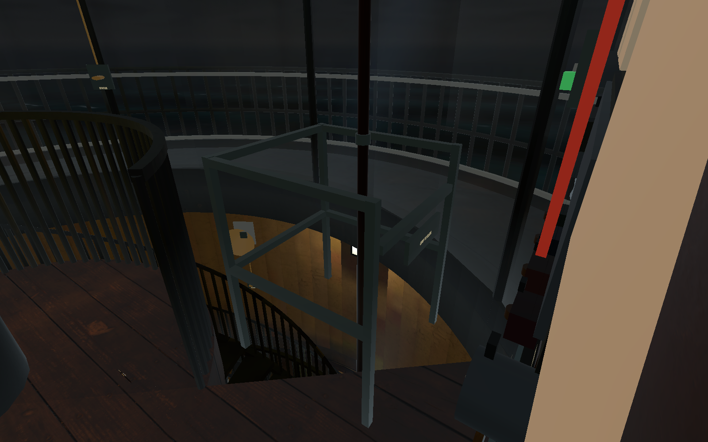
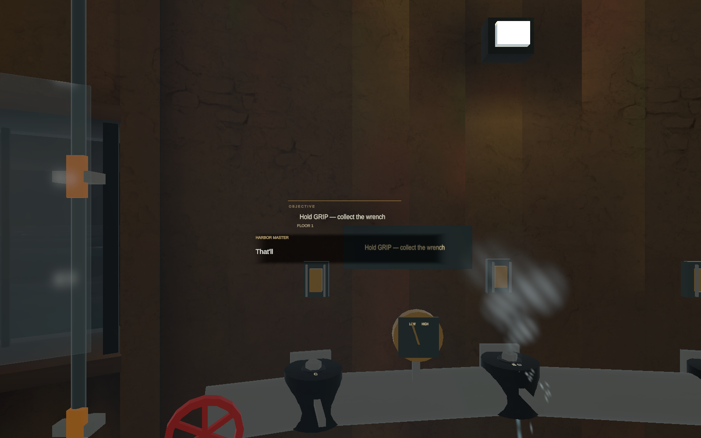
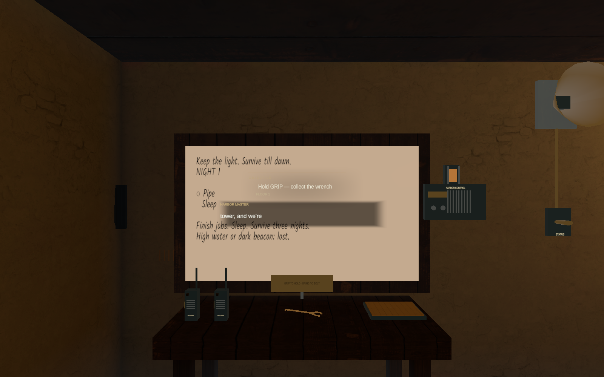
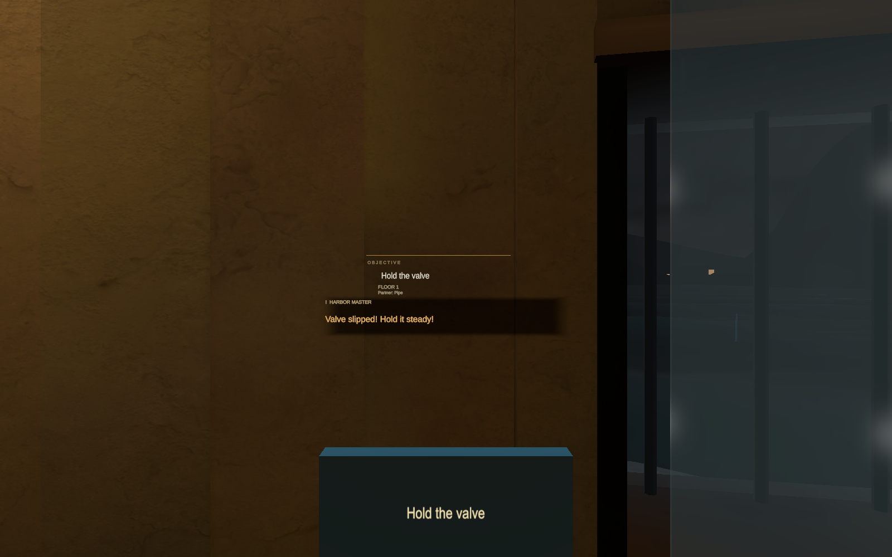
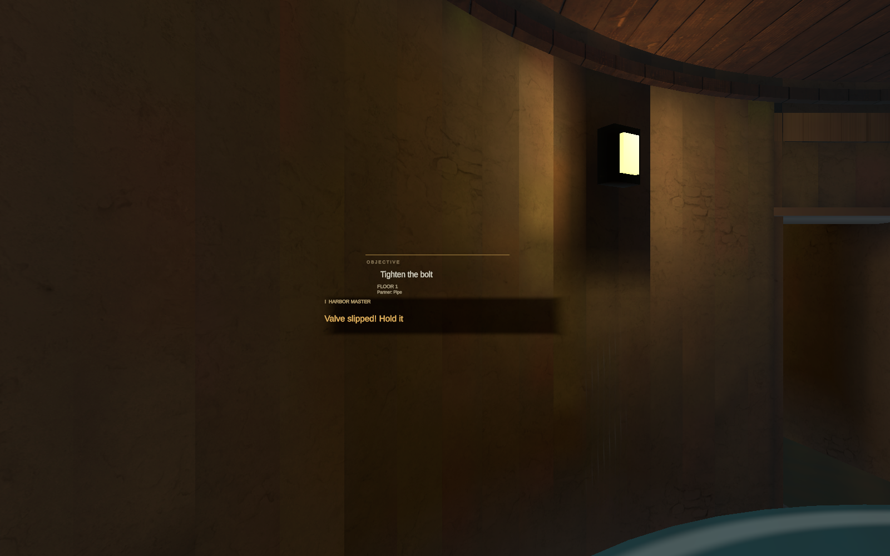

# Harbor master voice pass — verification

The lead confirmed the first installed voice build (c716030) was clear, with one take per line and no spoken numbers. Subsequent headset notes requested quieter, relevant narration, readable tracker text against walls, and a working, coherent fire pole. The latest changes are described in [headset feedback](headset-feedback.md).

## Audio and captions

94 mapped clips imported from local originals/converted recordings; raw sources unchanged. Every mapped caption matches the supplied script. All outputs are mono 44.1 kHz, 16-bit WAV. Measured loudness: −18.34 to −17.74 LUFS; highest true peak −1.35 dBTP. Every clip is under 10 seconds except the complete 11.79-second arrival, retained without speeding it up.

[22 conservative ASR/review flags, exact numbers and text](needs-check.md). These are not 22 confirmed bad recordings; several are recognition ambiguities. [Split/attempt report](split-report.md), [five-line old/new filter comparison](radio-ab.md), [all trigger mappings](triggers.md). P19–P26 are imported only, not wired to nonexistent gameplay.

## Checks and limits

- Full EditMode earlier in the pass: 326/326 passed. Latest focused voice checks: 23/23 passed (all 94 mappings/captions/timings, 18 P-line gates/rates, network domain, SDF overlay and two-line narration budget).
- Full PlayMode earlier in the pass: 43 passed, 26 failed, 3 cloud-test opt-in skips. Two stale fixtures were repaired and passed; two new feedback regressions passed. Aggregate: 47 passing cases, [24 inherited failures](Verification/inherited-failures.md), 3 skips. This is not a new all-green full-suite run.
- Real direct hover and grip, both hands on both poles: passed, including pause/regrip, landings, local-only entrance collision bypass and restored fall protection. The final visual enclosure passed again, including plate orientation from the landing (6626b39).
- Narration context expiry, maximum two ordinary lines before a quiet stretch, and the existing 90-second idle hint policy: passed. Completion/next-job lines may follow after one second; after two ordinary lines, 20 seconds of quiet. Urgent warnings retain priority.
- Tracker render probes: inspected at the F1 wall and behind obstructing generator geometry. All tracker text uses an included SDF overlay above its backing; world-fixed placement/recall unchanged. These probes deliberately injected a short line for rendering, not gameplay timing.
- Solo Nights 1–3 graphics replay passed with zero logged errors: physical clamp/bolts, generator/fuel, grid, beacon, radio and sleep. Paced Night 3 finished with 163.85 seconds spare under the existing start grace; timings were not changed. This is automation, not a human first-timer measurement.
- Two live Mac/Fusion clients passed join, avatars, mono/AEC/noise-suppression configuration, both valve roles, valve-release pause with preserved progress, guest and host repairs shared to both boards, P7/P8/P10 cue + subtitle agreement, cross-floor proximity/PTT/head-radio routing, mute, shared sleep, host-alone fallback and rejoin. A fresh solo Night 1 also passed on final source 4021de5. This is transport/game-state verification, not a new human Mac+Quest listening test.
- Quest: APK built from 6626b39 installed successfully and the app launched. The lead confirmed pole operation and tracker readability on this build; requested a more reachable pole and continuous shaft. Narration cadence, human Mac+Quest listening and device performance remain NOT VERIFIED. The launch capture was black, so it is not evidence of a visible game view. Earlier c716030 speech clarity/one-take playback was confirmed by the lead.
- Installed APK SHA-256: `2b953ef447d04621d9a08afb5477673c7ea3cf77bf0c65ea24f69c90b633e46c` (127,799,114 bytes). Local file: `Builds/LighthouseKeepers-VoicePass-Quest.apk`.

No new replicated fields in the feedback fixes. Both players require **LK-S5-VOICE1**, snapshot v19, introduced by the expanded cue domain. Use the same APK on both headsets.

[Ordered solo narration log](Verification/solo-listen-log.md). [Co-op cue/subtitle log](Verification/coop-listen-log.md). The latest co-op run and focused test summaries are recorded in [verification results](Verification/results.json).

## Inspected images

## Six headset checks

1. PLAY SOLO: listen to arrival; no number or repeated take. Objective/subtitles remain legible near the F1 wall and generator.
2. Tap a PA button or recall the tracker with X/Y: check a clear status/replay and world-fixed text that can be placed in front of you again.
3. Night 2/3 outage: listen for a relevant danger warning, not stale instructions. Finish a job: at most two ordinary lines back-to-back, then quiet.
4. In a matching-build crew, go to the pipe: hear the valve role instruction; release the held valve mid-repair for its warning. Both keepers see the same speech.
5. At either upper pole, reach for the shaft and grip: descend, release to pause, regrip to continue. Check the railing and gate look attached and readable.
6. Finish the night and sleep together: check the completion/rest/close-call line fits the outcome, then the next night's job announcement.
