# Integrated lighthouse verification

Branch `s4/integrated`, network **LK-S5-INTEGRATED1**, snapshot18. Builds and tests below distinguish automated evidence from headset acceptance.

## Regression checks

Both unchanged branches were tested first: ours Edit280/280, Play40/65; Eli Edit284/284, Play39/64. Twenty-four failures are shared, with one additional failure on each branch. The union of their passing cases is the preservation target.

Integrated EditMode: **305/305 pass**. Full PlayMode followed by targeted reruns: **47 pass,24 inherited failures, no lost baseline passes**. [Per-case aggregate](tests-aggregate.json) records which run supplied each result. This is not a clean full-suite claim. Tests for the deliberately changed gate/input semantics were updated; the failures are not hidden.

Graphics Nights1–2 pass physical XRI clamp/repair/drop/recovery, generator startup, drain and sleep transitions. Night3 also passes all four tasks and sleep into Day4, with162.22s spare in the paced automation. This is not a measured human first-timer result. Live two-Mac PASS: both valve roles, release pause/preserved progress, shared guest/host repair, cross-floor proximity attenuation, trigger/head radio routing, mute, shared sleep, host-alone clamp and active-watch rejoin. Mono/AEC/noise suppression are enabled on both; human listening remains a Quest check.

The72-view rendered wall sweep was inspected as a contact sheet. It covers House, all four floors, stairs and gallery. Near-pillar views are occluded and still images do not certify continuous-motion flicker, stereoscopic glass sorting or device comfort.

## Device comparison limitations

The lead selected Eli’s exterior after playing both. [Raw comparison summary](device-comparison.json) includes render settings and stationary-sample limitations. Our captured F4 view at scale1.25 exceeded budget (25.97ms median GPU); Eli’s strongest-night gallery at scale1.0 was9.26ms median and72fps. Different views/resolution prevent isolating ocean-only cost. Integrated uses scale1.0,4xMSAA and fixed foveation0.5, pending its own device profile.

## Local reproduction

Raw logs, screenshots and scripts: `artifacts/reconcile/` in the primary worktree. `integrated_graphics.py` / `replay_day3.py` run actual XRI mechanics with explicit first-timer navigation/reading waits. `integrated_crew.py` uses two live Fusion Editor clients, not simulated snapshots. `build_integrated_isolated.py` builds the exact integration source from a separate checkout, preserving the live test Editors.

The Day3 timing assertion retains its prior115–155s spare range plus the requested start-grace allowance. The first integrated run completed all tasks with162.83s spare but stopped at the obsolete upper bound; gameplay timing was not changed to make that assertion pass.

## Inspected Editor captures

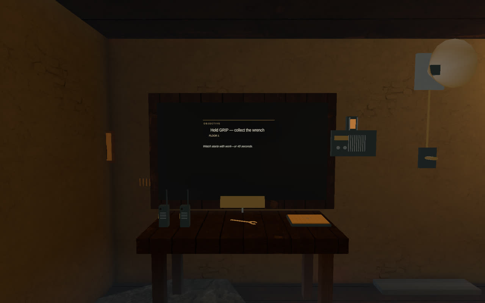
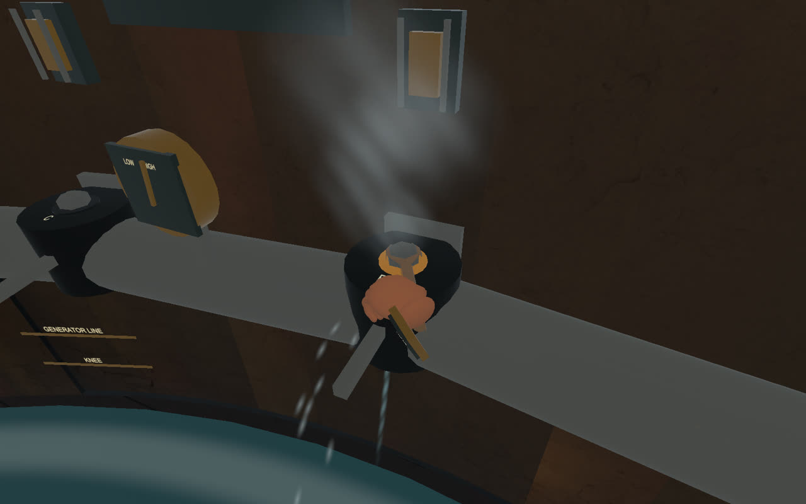
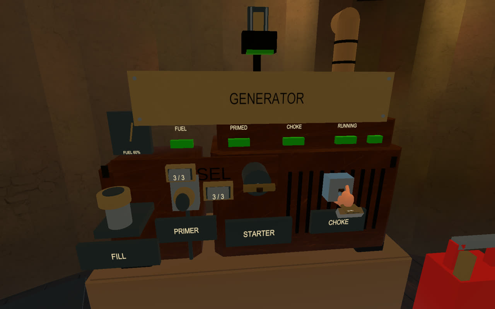
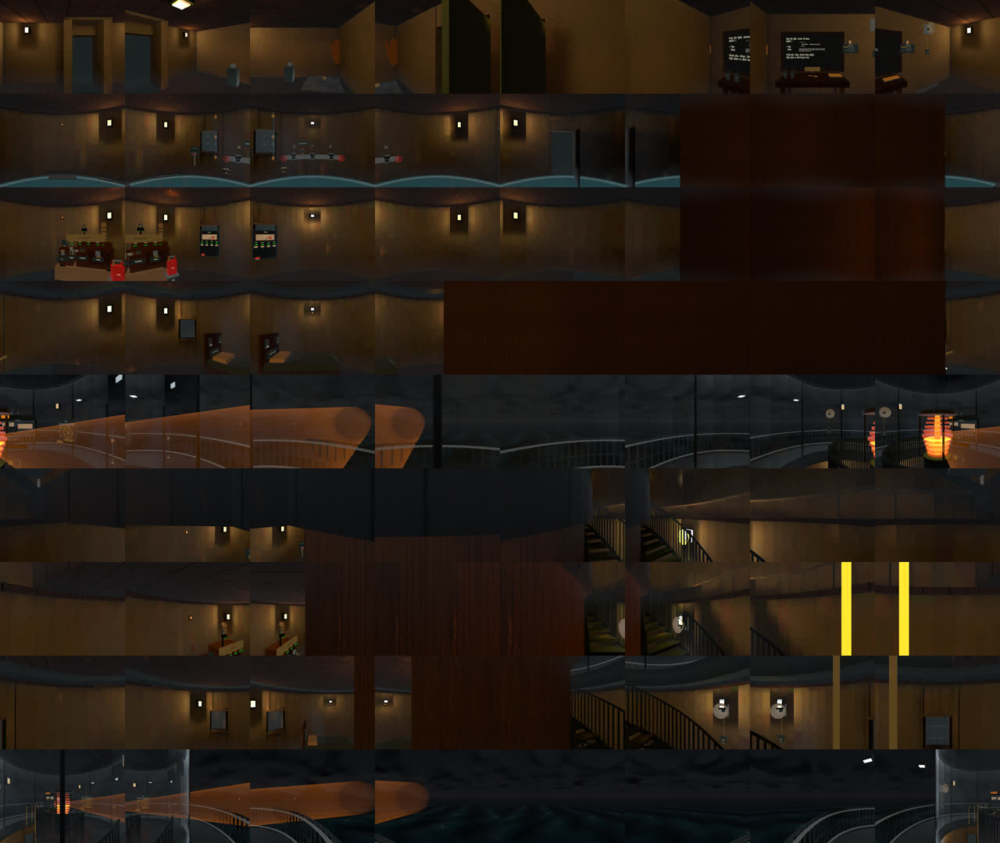

The generator capture is from the first Night3 run: its tasks completed, but the old timing assertion stopped it before sleep. The scene is the same integrated source; the later replay will record the complete transition.

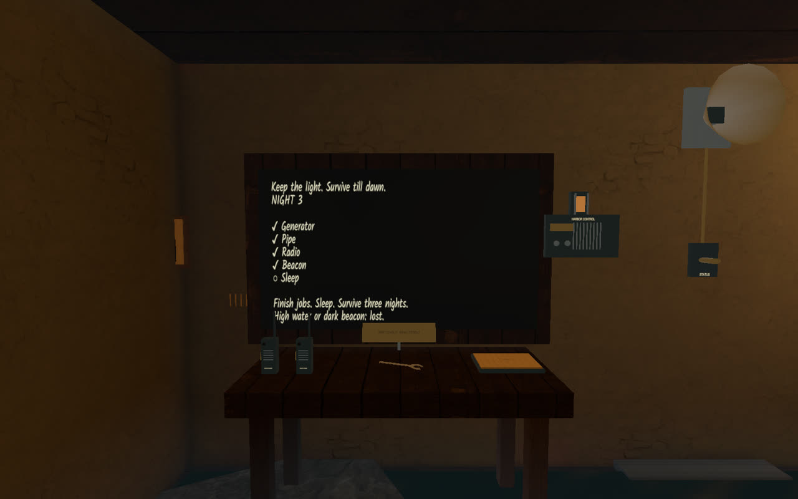
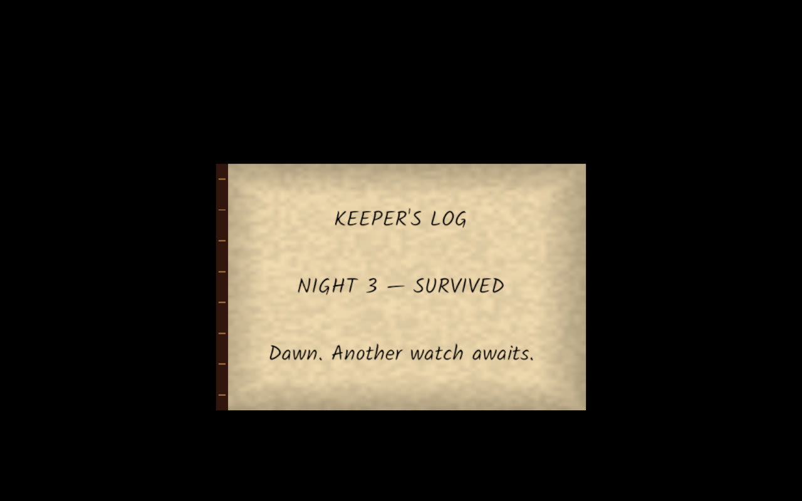

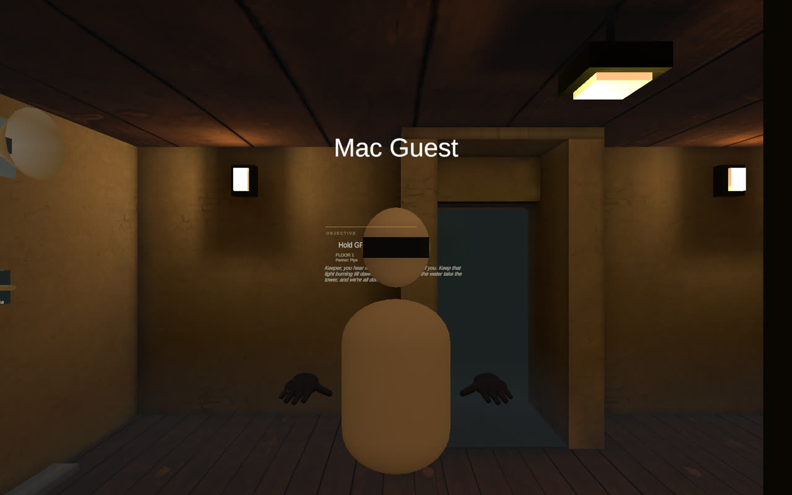
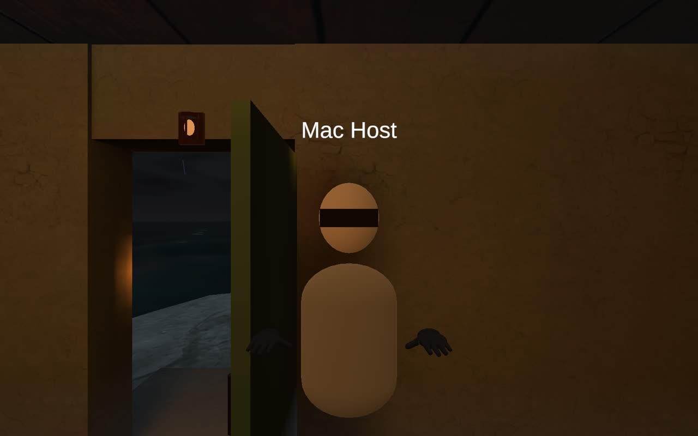
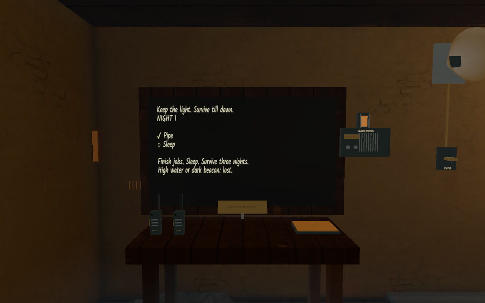
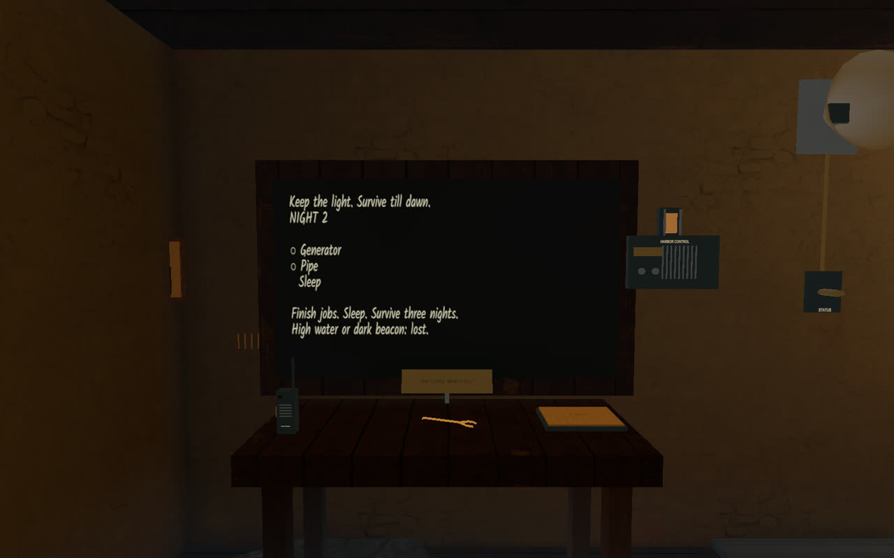
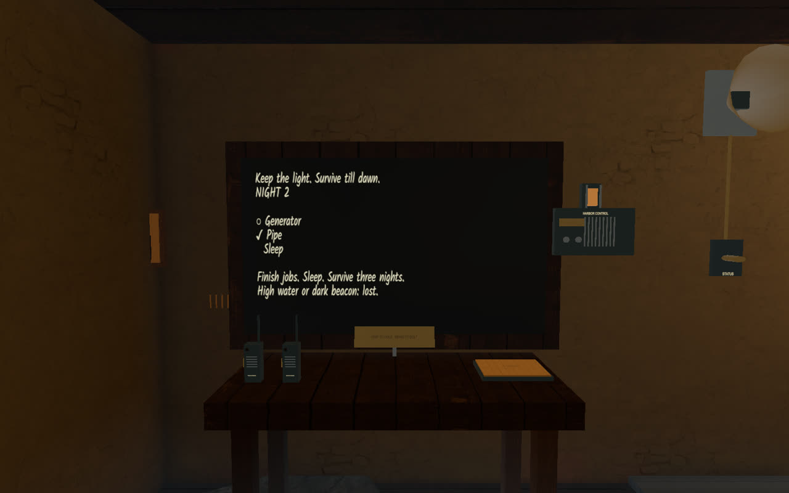
