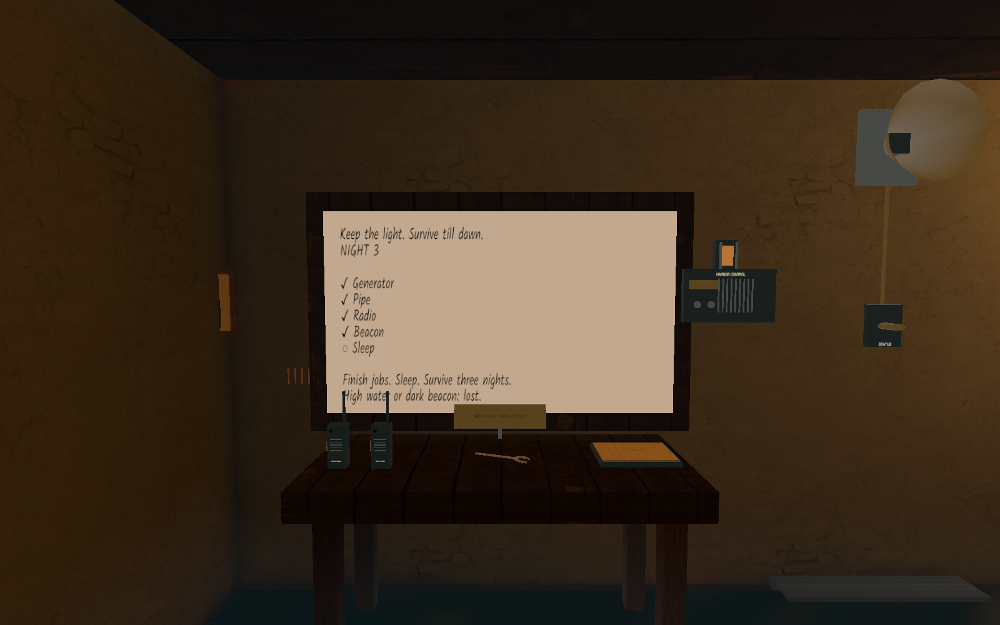

# Headset feedback cleanup

House board: white enamel, black writing, existing live job list unchanged. A neutral minimum brightness keeps the white face readable in warm/dark lighting; no extra light. Inspected the rendered board after the writing textures populated (the first capture was taken too early).

Removed the three shell outcrops protruding through the House floor (SM_Rock_Outcrop_7/8/9). Removed the misplaced oilskin, crate/rope, fallen lantern and stove/kettle from the procedural dressing source. Retained the desk logbook, wall photograph and tally marks. Future dressing needs an actual rack/cabinet/support and safe room clearance.

Mounted tower PA horns and stair service lamps against real shell walls/lantern frames, searching for clearance around the entire fitting. Disabled the two authored F2 lamp meshes intersecting stair rails; existing practical stair fixtures cover the route. Skip duplicate generated lamp housings that intersect railings. Fireman poles retain their slide mechanics, with dark non-emissive brass instead of bright yellow.

Validation: 4 integrated presentation checks, House-to-gallery traversal, 2 render-quality checks pass. Screenshot evidence is in fixture-cleanup/. These checks exercise the runtime scene; headset comfort/reach and continuous visual sweeps remain pending. No replicated fields changed: LK-S5-INTEGRATED1 remains the matching-client version.

Performance: the previous installed4×MSAA build exceeded the11ms GPU target in observed views (including roughly12ms atF3 and17–18ms on moving stair views). Next build uses the authorized2×MSAA fallback at scale1.0. No claimed improvement until measured on Quest in matching views.

Pending user feedback: preferred treatment of tracked hands crossing walls, and whether the left-wrist NIGHT square is attached correctly or floating. Neither hand tracking/rotation nor wristwatch behavior was changed by this cleanup.

Fresh post-cleanup graphics replay: solo Nights1–3 pass with zero logged errors. The Night3 board screenshot shows all four task ticks in black on the white face before sleep.

Fresh two-Mac live Fusion replay passes join/avatars, both valve roles, preserved progress on release, shared repair, radio/proximity routing, mute, sleep, host-alone clamp and active-watch rejoin. These are transport/mechanics checks, not a substitute for human Quest listening or comfort.
