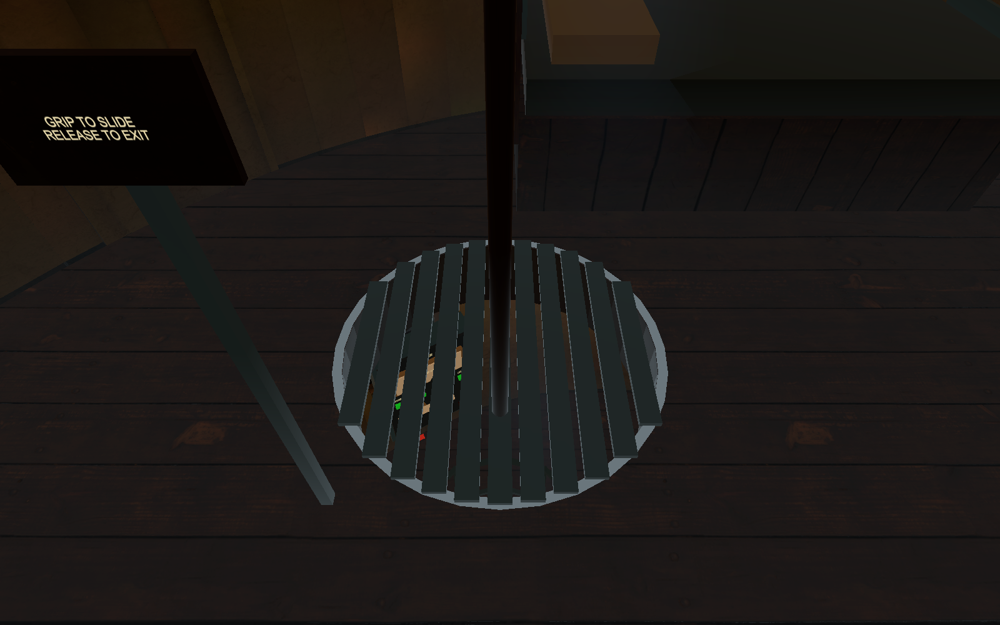
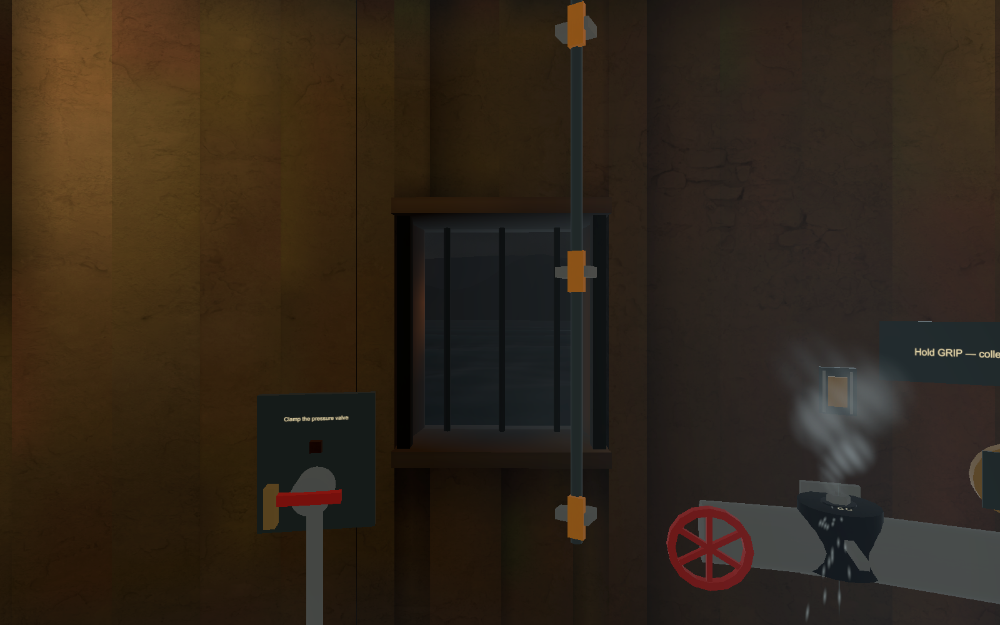
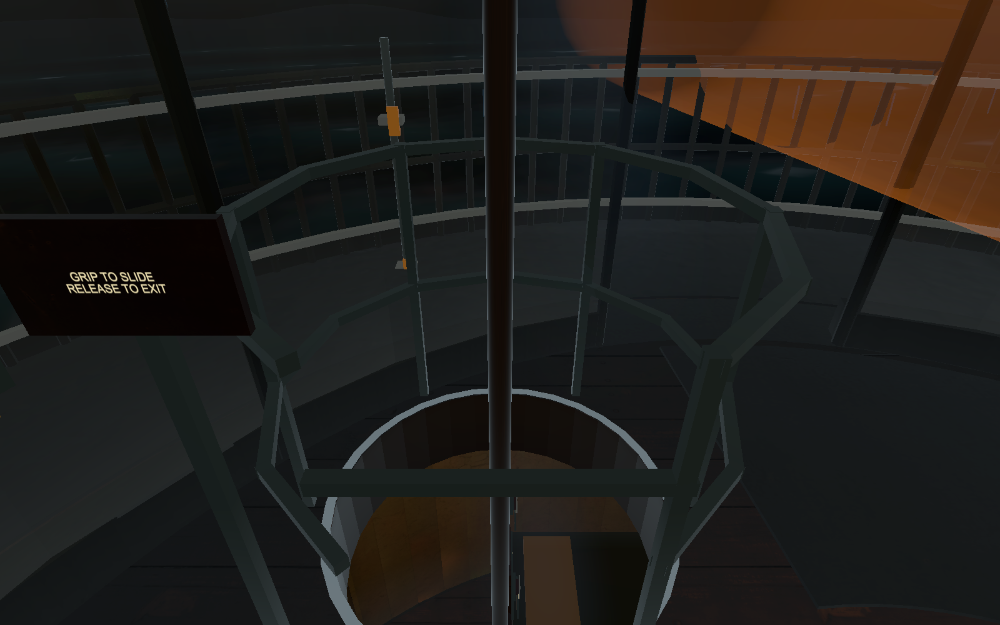
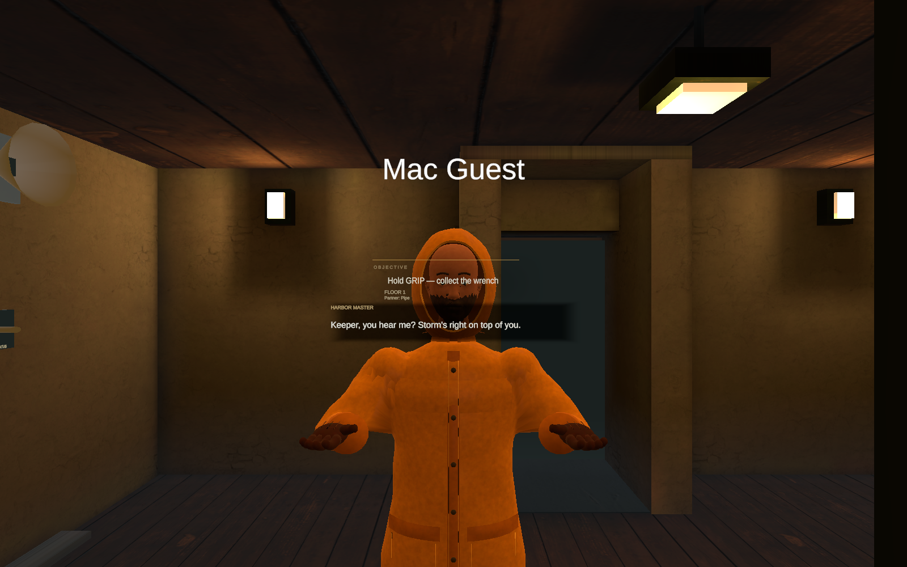
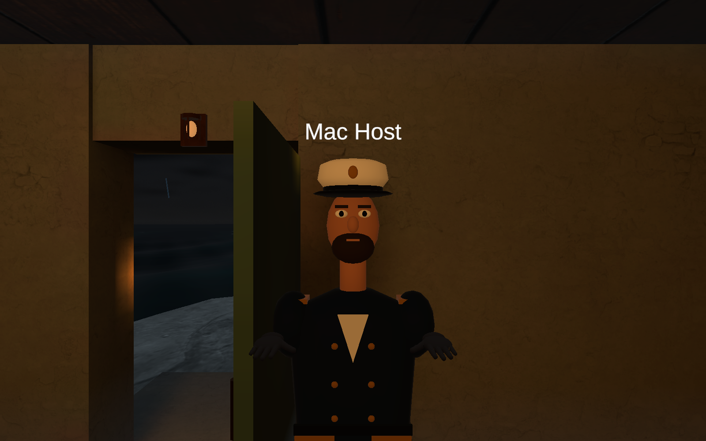

# Pole, avatars and merge-candidate verification

Source **a9d5f2d**, branch `s4/integrated`, PR #85. William Qian’s PR #86 (`f9b8fd5`) was merged in `08a8e69`. Nothing merged to main. Network **LK-S5-VOICE1 / snapshot v19**; both players should install the same APK. Appearance/hatch animation uses existing poses, with no new replicated fields.

## Changes and acceptance

One continuous pole runs beside the rooms through circular F2/F3/F4 openings to ground. The sign is beside the grip path. Holding grip slides; release near a floor exits onto its landing, while release between floors pauses. F3 has a flush hatch instead of an upright cage. Personal collision exceptions end when the keeper steps off; other keepers retain fall protection. Mesh/collision authoring survives rebuilds.

Will’s Captain host and rigged fisherman guest appear remotely; local body, cameras and listeners remain hidden/absent as appropriate. Local tracked hand rotation is unchanged. His Interior Flood Water shader is preserved instead of overwritten at runtime. Existing flood height/rules remain. Detached procedural rain panes caused the floating white-dot window sheet and are removed; real glazing remains.

The lead accepted the c8178f3 full descent, then reported inability to exit at intermediate floors, the bedroom cage and floating pane. Those follow-ups are implemented and tested below. Latest release-to-exit comfort, remote avatar appearance and water appearance on Quest remain **not yet human-verified**.

## Results

| Check | Result |
|---|---|
| Fresh full EditMode | **351/351 passed** |
| Fresh full PlayMode | 47 passed, 25 failed, 3 skipped |
| New hatch-edge failure | Fixed a tiny seam by overlapping the support 2 cm; four safety tests passed in both Editors afterward |
| Final comparison | **48 passing cases, same 24 inherited failures, 3 skips; no new unresolved failures** |
| Pole interaction | Both hands, all three starts, pause/regrip, full descent, F2/F3 exits just above/below floor, walking restoration and guards passed |
| Actual House→gallery→radio walking | Passed with the route around the new aperture, not through its centre |
| Graphics solo Nights 1–3 | Passed, zero logged errors; Night 3 completed jobs and slept into Day 4 |
| Two live Mac/Fusion clients | Join, both appearances, both valve roles, preserved progress on valve release, shared tasks/boards, shared captions, proximity/PTT/head radio, mute, shared sleep, disconnect fallback and rejoin passed |
| Voice configuration | Mono, DSP, AEC, noise suppression and reference input verified on both Mac clients; this is not a human listening test |
| Quest | APK installed and launched; latest usability/performance checks pending |

[Comparison and inherited failure names](comparison.json). Full-run results and focused reruns are kept distinct; this is not an all-green full suite. Earlier stale second-Editor doorway fixtures were refreshed, and the obsolete F4 path through the shaft was replaced with a tested physical route. No unrelated inherited test failures were hidden or repaired.

Raw evidence: `artifacts/pole-avatar/final/`. The unrelated local player-prefab ray-width edit is preserved and excluded from commits/APK source. Device GPU/CPU budgets and two-Quest execution are **not verified** by these Editor checks.

## Inspected images

The remote Captain is Will’s simpler appearance; the guest is his full rigged fisherman. These screenshots confirm the integrated models, not a new avatar art overhaul. The raw initial Quest capture showed passthrough and was discarded, not counted as game evidence.

## Installed APK

`LighthouseKeepers-Integrated-a9d5f2d.apk` — 133,764,782 bytes, built from `a9d5f2dc0629cb4f701c7aa2a8441fe2a0e01a5e`.

SHA-256: `95386545b0fd77f9d56fd9c33cdc4cecd25e773cd5a00b02ba822a22838a692f`.

Installed with `adb install -r` and launched on the connected Quest. The Milestone 2 release/tag will be made only after the lead confirms #85 is merged, from that exact main merge commit.

## Short headset check

1. PLAY SOLO, climb to F4, grip the side pole; release near F3/F2 to step onto that floor. Keep grip held to descend to ground.
2. Check the bedroom’s flush hatch and F1 window; normal stairs and bunk remain accessible.
3. Join a matching-build crew; confirm Captain/fisherman, moving hands, nearby speech and handheld radios.
4. Repair together, sleep together, leave and rejoin. Report any new collision, audio or tracking issue.
