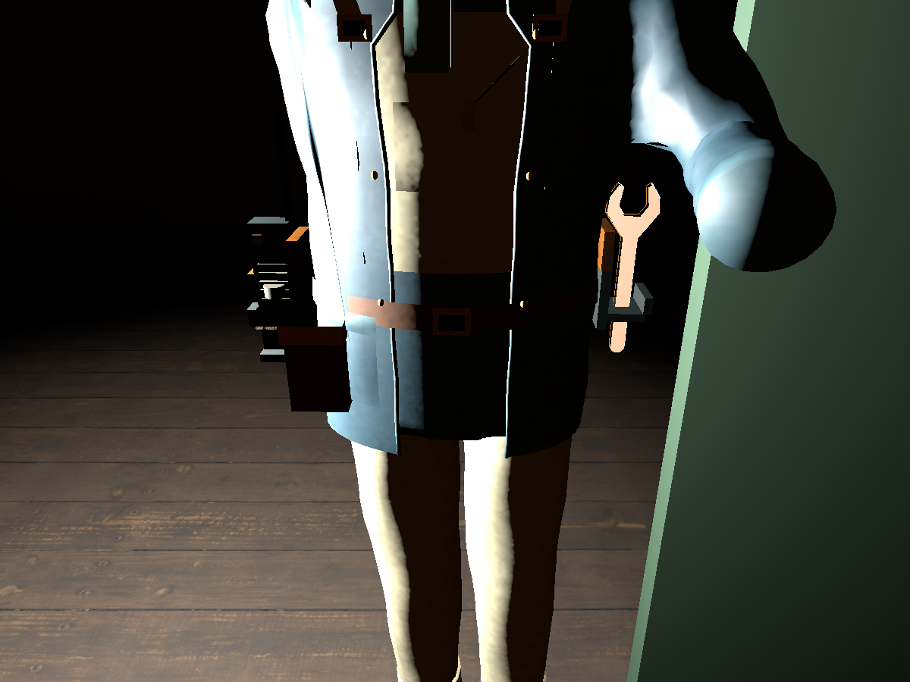

# Body-attached tool holders — Editor evidence

The radio and wrench now use separate holders aligned to the local avatar's animated hip instead of fixed positions in front of the headset. The holder and carried item use the same pose, including the body's turn smoothing and stature; an HMD-relative fallback is used while the local body is not tracked. The unused flashlight holder is gone. The host accepts a carried pose only within a bounded waist region; this allows torso lag during a fast head turn without transferring ownership or adding synchronized fields.

Muted verification: 41 focused EditMode checks across belt pose, radio, headlamp and network version; 4 local-body PlayMode tests including different heights, turns and crouching; 20 simulated XR grip/clip/regrip/release checks. In a live two-Editor Survival session, the guest clipped, turned, regripped and released both the wrench and the radio; the host agreed on ownership and the carried state. These are not physical headset, full-night, voice or rejoin tests.

The following capture was inspected to check the modeled torso, separate wrench loop and radio holder. A temporary Editor-only inspection light was used for visibility; it does not exist in the game. Darker and additional captures and test logs remain in `artifacts/s5/body-belt/`. [Fixture](fixtures/BodyBeltCheck.cs).

Network for this step: `LK-S5-BODYBELT1 / LK-Lab-Coop-v57`. Both keepers must update. Worn grip reach, clipping while moving/crouching, comfort and performance still require Quest testing.

Quest APK from source `003a8cbe` was built, installed and hash-verified without launching: SHA-256 `4f1e07e96cbc8a82b2eb1a6688de231262443302e9ea4b1644aec7677eb4f3c3`. ARM64, package ID, VR intent category, APK signature and archive integrity were checked. This is installation evidence, not a headset playtest.

After the APK was installed, the source was cleaned up to supply the active hip through a local presentation bridge, avoiding a new direct gameplay-to-network dependency. The same 21 simulated grip/attachment checks passed. A muted full EditMode run passed **708/715**: [comparison](suite-comparison.json). The same seven cases failed as in the earlier baseline. The objective-length test now encounters the clearer wrench wording first; the existing networking-boundary test again reports only its original five references. This cleanup is not in the installed APK.
