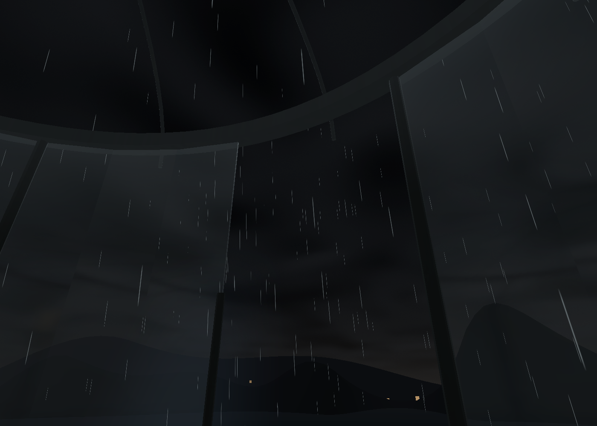
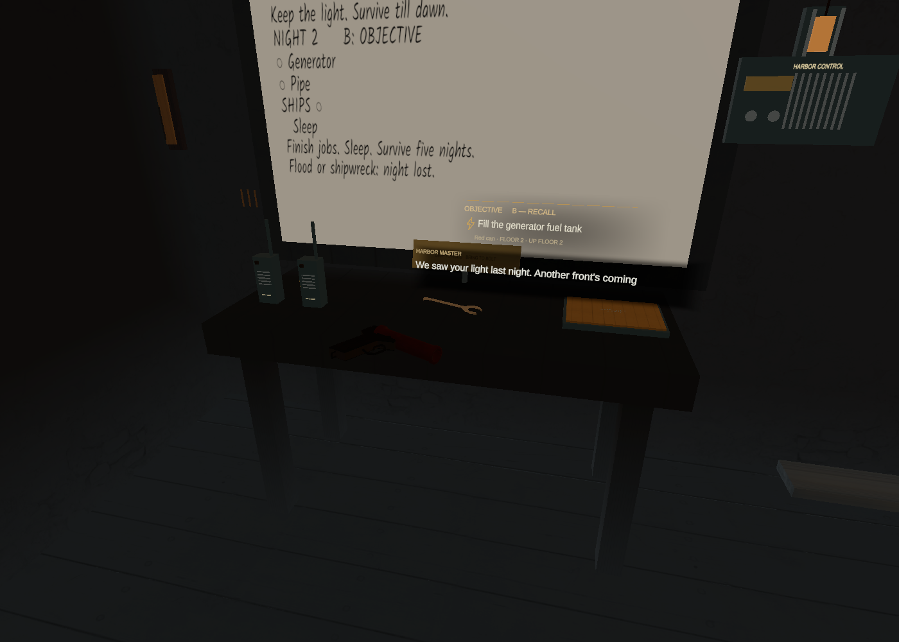
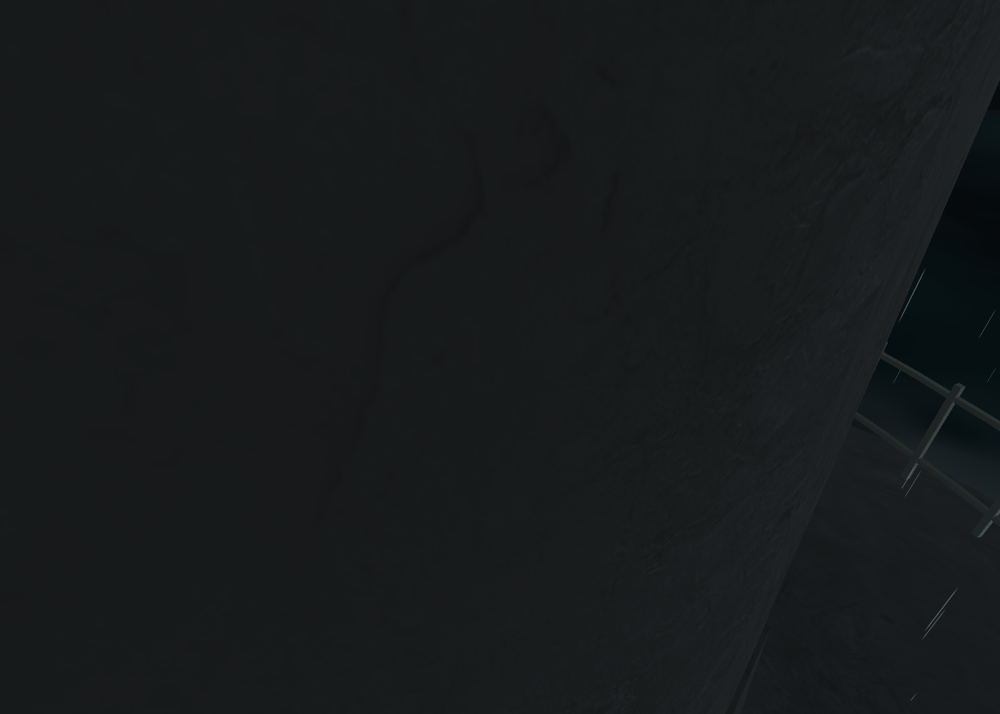
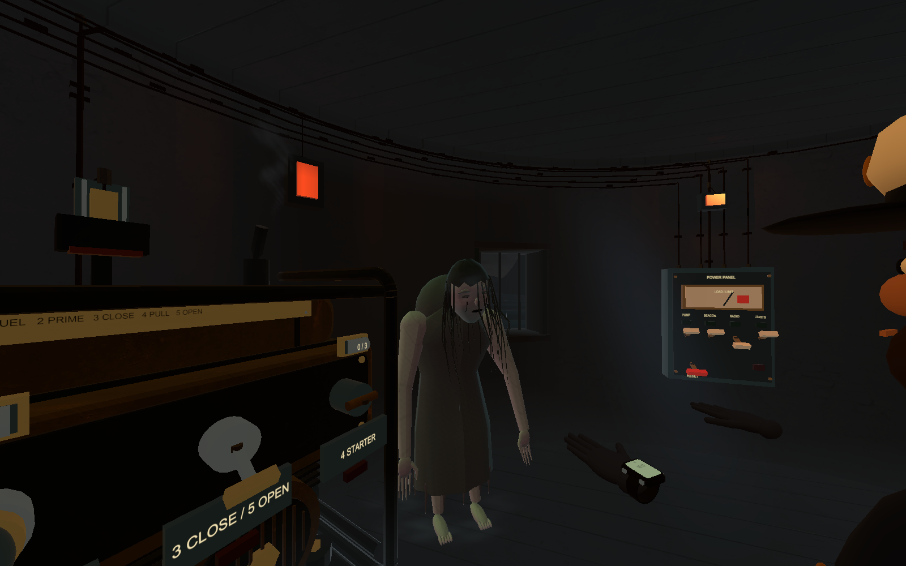

# Brief encounters and physical cleanup — November 16

Network LK-S5-DREAD1 / LK-Lab-Coop-v33. Both clients update. Main was not changed.

89 focused EditMode checks passed. Graphics Play Mode verifies fuel can gravity and eight-second return with either hand, filled pole holes, one bench flare and red wheel marker in front. Final wiring geometry: **10,912 triangles**, zero unexpected collider contacts. Exposed F4 runs are retired; generation cannot put the photographed lamp or cable loops back across the glass. Screenshots opened and inspected.

The solo Night3 replay uses actual XRI interactions: pipe, fuel tilt, primer squeeze, choke, starter, radio, beacon steering, two ships and sleep toNight4. It passed with zero logged errors. This is an automation regression, not a first-timer timing measurement.

Two real Mac Unity clients connected through Photon. They matched the host-selected form/anchor/pose, reveal/score route, near-face suppression, authenticated guest flare shot and replicated repulsion. An unowned reserved gun slot was rejected; spent gun could not fire twice. Guest fuel-can release became dynamic on the host, fell 0.74m in the sample, reached the guest and returned on both. Subsequent task state still arrived. Both Editors stayed muted: human voice clarity and headset comfort are **not verified**. Shared bed/rejoin were not rerun in this focused smoke.

The old capture fixture missed the new 1.15-second reveal while collecting diagnostics. The corrected fixture catches Manifest immediately and temporarily slows host game time for screenshots/aiming; production encounter durations are unchanged. Unit checks verify the real 1.15/1.8/4.8-second exits. This slow-motion fixture is not a performance measurement.

See [design details](../../../Design/DreadPlaytestPass.md). Current models remain original stylized low-poly figures. Actual hunting/hiding remains unfinished. Device CPU/GPU, scare acceptance, arm-swing feel, darkness readability and listening remain pending.

