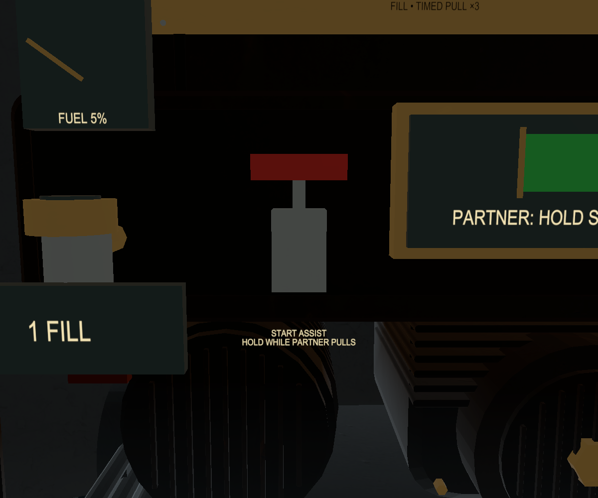
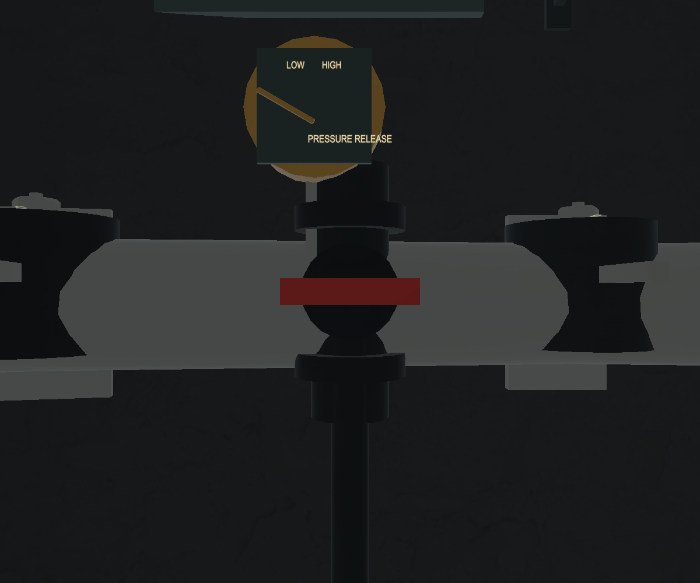

# Paired stations and equipment — November 18

Source `ad33062a`, issue #142, PR #89. Both Campaign and Survival use these shared interactions.

## What changed

A single pressure-release handle stays beside the pipe while all three bolts are repaired. The generator keeps its three timed pulls: a second keeper holds START ASSIST. Owen supplies the other duty in solo. Radio instructions identify the floor and control; the complete ordered code is shown together, the Machinist owns the House clue, and frequency changes each day. Walkies clip to the right hip; lanterns attach at the bail, remain where dropped, and go out underwater. Cloth/wipe progression is removed. Stair backing is solid, lighting is darker, and Owen's duplicate beard shell is removed.

## Evidence and limits

- 40 focused combined EditMode checks passed, followed by 9 focused checks for the network command correction. These groups overlap; they are not 49 unique tests. Full suites were not rerun.
- [16 XR input-path checks](physical-input.json): actual scene hover/select with manual grip/trigger readers, including hold/release and dropped equipment beyond 20 seconds. Scripted Editor input, not physical controllers on a worn headset.
- [Owen navigation](owen-navigation.json): walks to F2 and holds START ASSIST, then fetches and reports all four code symbols.
- [20 navigation/collision routes](navigation-routes.txt), with 76 solid stair backing panels.
- [Two live Editors](crew-events.jsonl): guest grip/release on assist and valve reaches host, role clue differs, lantern/radio state replicates, leave/rejoin retains clearance, guided passage and shared sleep advance both to Day 2. Preparation and passage were scripted; no audible voice or complete human night run.
- Powered and emergency lighting rebaked. No extra realtime lights.
- [APK receipt](delivery.json): IL2CPP ARM64, package/signature/VR manifest checked, installed APK SHA-256 matches. Installed, **not launched**.

The live transport run caught a command whitelist rejecting the new assist action; fixed before delivery. Network `LK-S5-COOPFIX1`, transport `LK-Lab-Coop-v50`: both players must update.

## Inspected Editor images

[Owen front](owen-final-front.png) · [left](owen-final-left.png) · [right](owen-final-right.png). Protruding beard geometry is removed; a fine facial shading seam remains a polish/headset check. First-person body vertex positions, triangle count and skeleton are unchanged. Images do not establish headset comfort, reach, legibility or GPU cost.

## Headset checklist

1. Start Survival Day 1 as Lightkeeper. Owen should perform the complementary duty; repeat as Machinist when convenient.
2. At F1, find the red pressure handle beside the pipe. Hold/release through all three bolts; it must stay in one place.
3. At F2, refuel, then one keeper holds START ASSIST while the other makes three timed pulls. Release midway; progress must respect the hold. Check Owen fills the other role.
4. Grip the lantern at its top bail. Set it down for 30 seconds, retrieve it, submerge the flame in floodwater, then relight it above water.
5. Release a walkie beside the right hip to holster it; grip to retrieve. Request Owen's code and check that all four symbols appear together, including with B recall.
6. Go to F4 radio, grip/lift its power lever, tune to today's frequency, enter the entire code, then grip the mic and hold trigger until transmission finishes. Frequency should change next day and remain stable on retry.
7. With two humans, the Machinist reads the House clue and relays it to the Lightkeeper. Check audible proximity voice, walkies, assist, valve, shared sleep and rejoin; both devices need the new network version.
8. Walk the F3 bedroom/stair partition; neither player nor Owen should pass through it. Inspect Owen's face and lantern-lit visibility on each floor. Confirm neither mode asks for a rag. Record sustained CPU/GPU separately.

## Workstation interruption

Two stale Unity crash reporters were stopped after macOS reported one at 95.31 GB. Their logs were preserved locally under `artifacts/s5/interaction-fixes/crash-reporters/`. Test Editors were closed; the Android build completed successfully. This resolves the runaway processes, not a proven permanent fix for Unity's crash-reporting memory bug.
