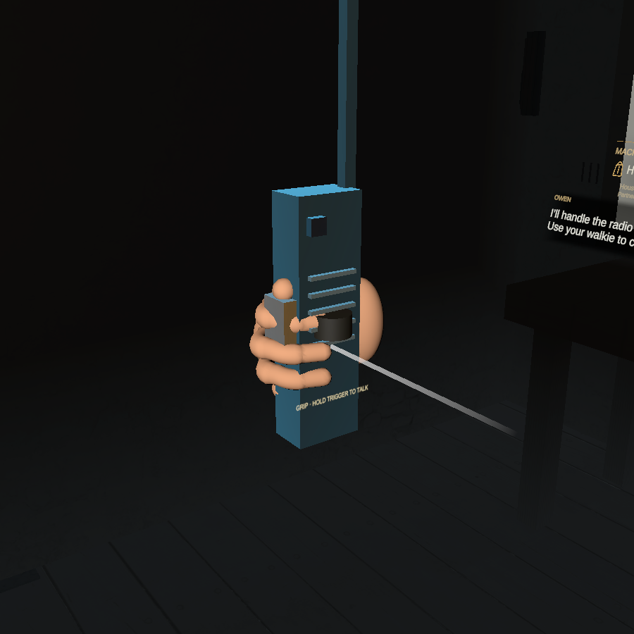
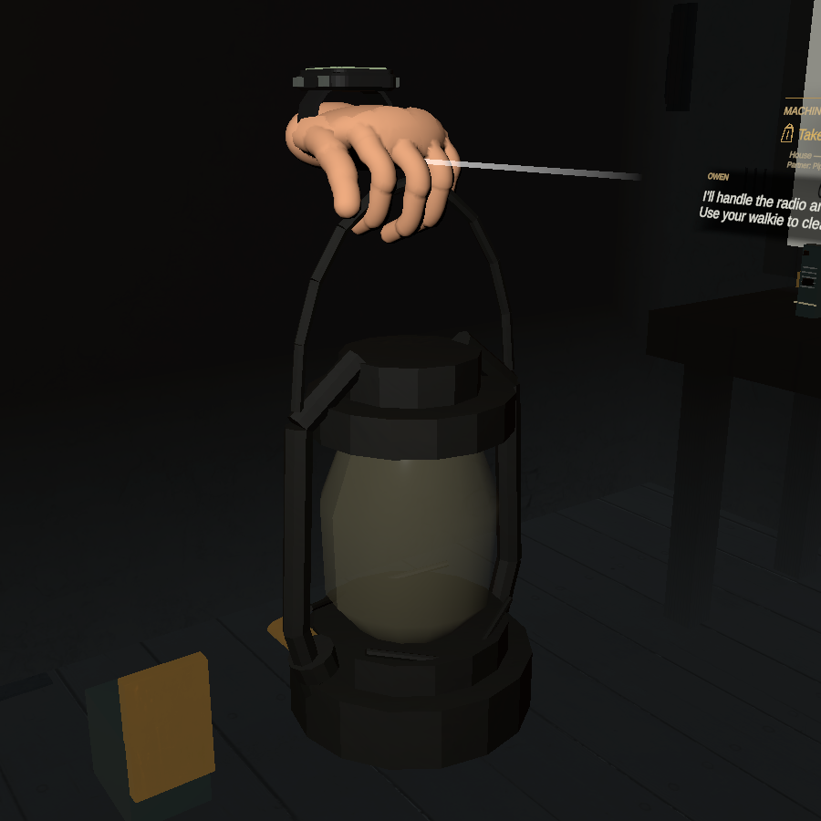
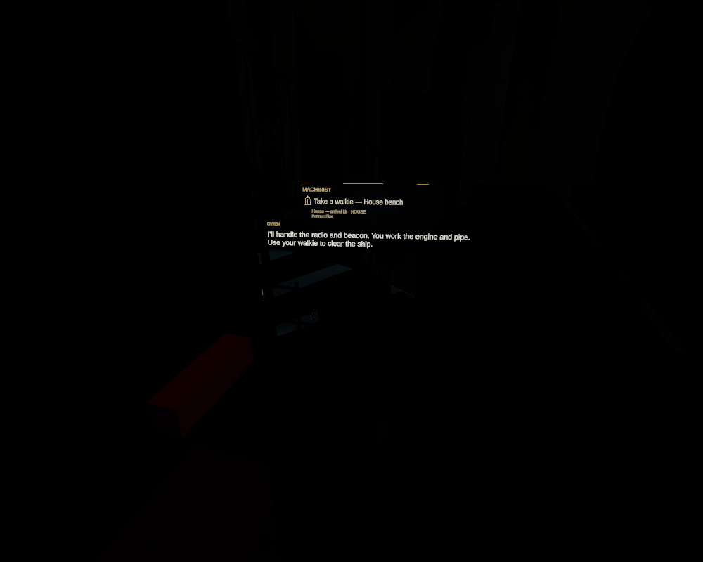
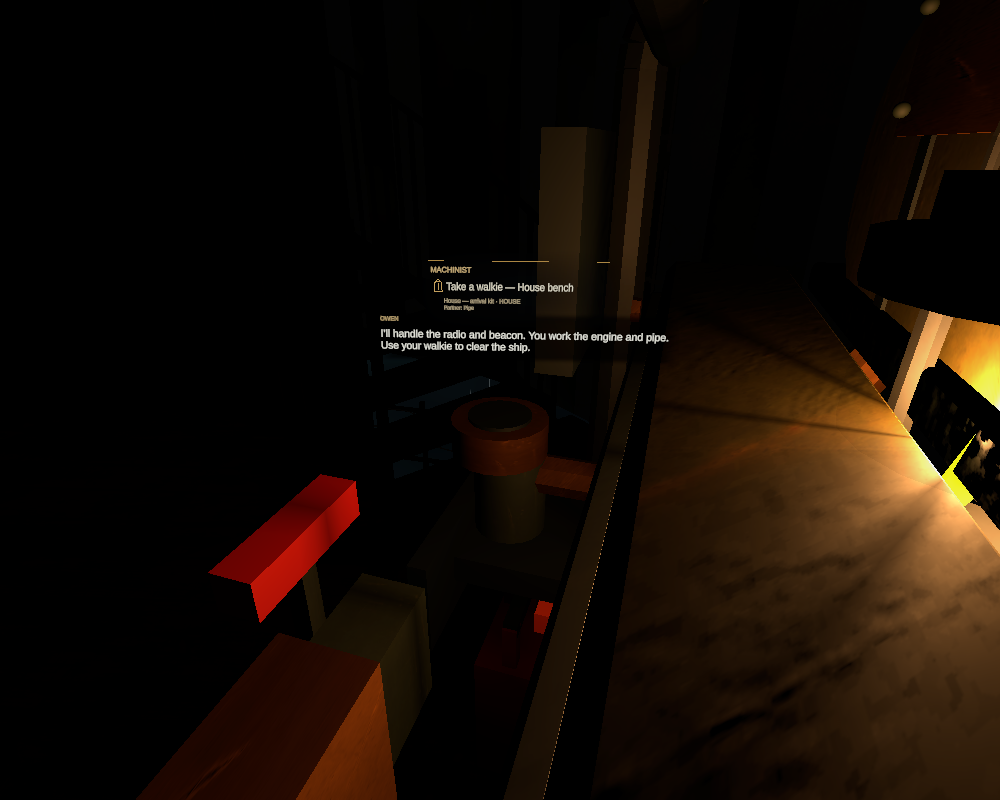
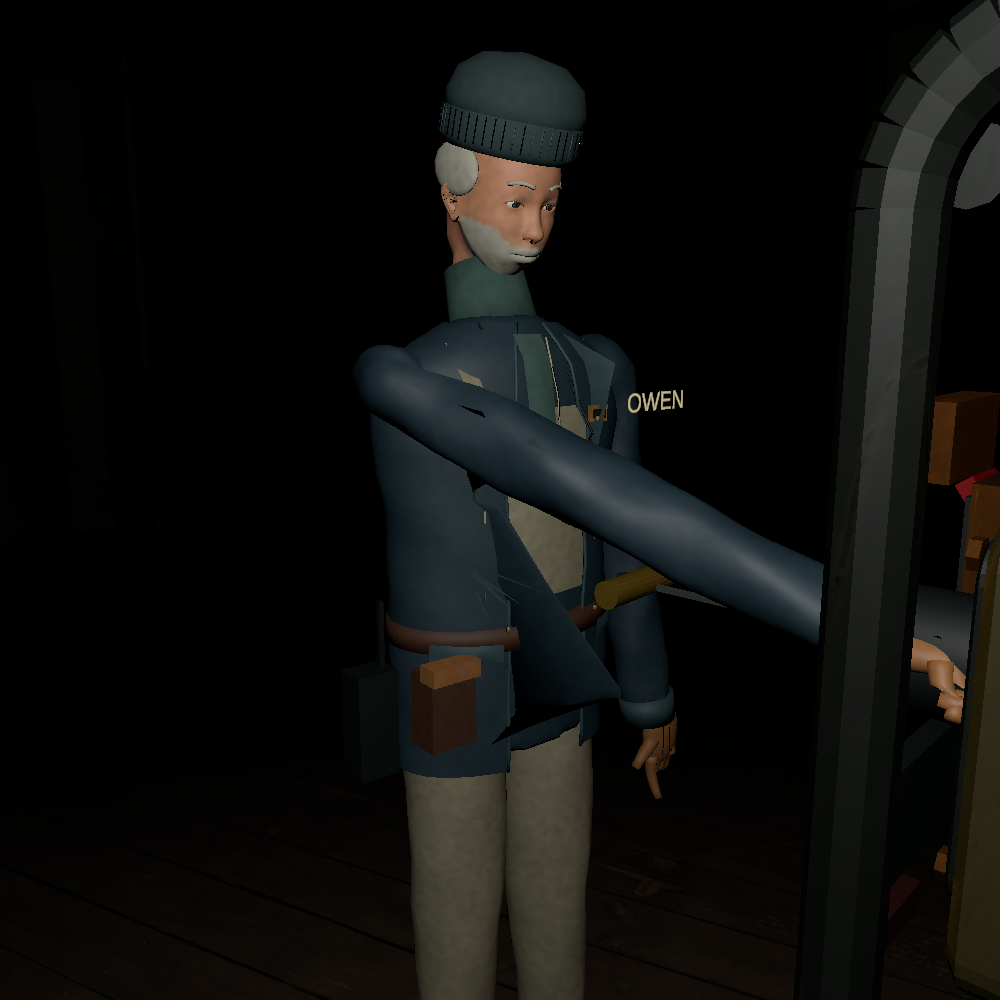
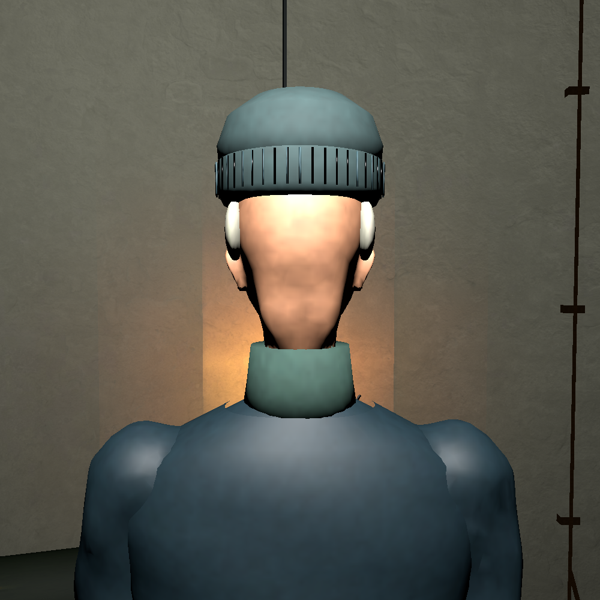

# November 18: grip, darkness and helper follow-up (#142)

Shared by Campaign and Survival. This pass changes presentation and early-night tuning; no new snapshot fields. Matching clients use **LK-S5-GRIPDARK1 / LK-Lab-Coop-v50** because early grace validation depends on matching assets.

## Changes

- Walkie case fits inside the curled fingers; left/right grip contacts are separate. The existing right-hip holster remains. Lantern grip is quarter-turned so the top bail sits inside the fingers. The beacon wheel uses the nearest rim contact, retaining alignment on release/regrip.
- Blackout uses the actual unpowered lightmaps. Removed incidental material glow, ambient fill, window shafts and room-filling beacon point light. Five weak hanging bulbs use baked pools; LOW lantern range is 0.8 m and HIGH is 1.5 m. No realtime path tracing; the moving lantern remains realtime and shadowless.
- Owen visibly pours, pulls the starter cord, works a spanner on the pipe and reaches for controls. His opening message describes engine → pipe → ship preparation together. The neck stump now fits inside the collar. Existing first-person body positions, joint definitions and triangle count are preserved; UV packing changes with the rebuilt atlas.
- Nights 1–2 get 20 seconds more opening/first-station grace. Survival flooding is 20% slower on Day 1 and 10% slower on Day 2. Campaign Night 2 flood multiplier is 1.3 (was 1.5). Day 3+ pressure and the fuel-filling requirement remain.

## Evidence and limits

Editor audio was muted throughout. 30 actual XRI grip/contact/regrip checks pass. 73 focused EditMode checks pass across quality, lanterns, world collision, Survival, campaign order, companion, timed starter, keeper body, voice and story imports. The old campaign fixture was updated to hold START ASSIST when testing two keepers; it no longer bypasses the paired starting rule.

Actual powered/emergency map selection was checked on return/loss of generator power. Both sets were rebaked with Unity Progressive GPU: two maps per state, 444 light probes and 2,227 static renderers. Off/LOW/HIGH images were inspected. These are screenshots, not GPU measurements.

Live helper verification uses a real navigating Owen with simulated human support inputs and a frozen flood controller. It exercises refuelling, three timed pulls and all three bolts. This establishes those interactions; it is not an uninterrupted human night playthrough. Grip/keeper photographs use a temporary review light to inspect geometry; only blackout/lantern-high images show the gameplay lighting.

Not verified this pass: human grip comfort, worn darkness/navigation, sustained Quest GPU/CPU, full solo Nights 1–3 or audible two-headset voice. Prior two-Editor evidence is in [EquipmentRelay](../EquipmentRelay/README.md); this pass rechecks snapshot compatibility in focused tests, not live transport. Issues #142 and #141 remain open for headset acceptance.

## Inspected images

## Headset check

1. Start Survival, Machinist. Grab each tool with each hand: fingers should wrap the walkie and lantern bail. Clip/retrieve the walkie at the right hip.
2. At the unpowered generator, compare lantern OFF / LOW / HIGH. HIGH should reveal the controls; distant corners should stay dark. Report any unreadable essential instruction.
3. Fuel the engine and let Owen hold START ASSIST while you make three timed pulls. Look for one weak bulb per room, smooth flicker and cords ending at solid ceilings.
4. As Lightkeeper, hold START ASSIST while Owen starts the engine, then hold pressure while he works the bolts. Watch his hands, cord, spanner and collar.
5. On the F4 gallery, grip the beacon wheel at top, bottom, left and right; release/regrip without an alignment jump.
6. Play Days 1–2 at your usual pace. Note whether the extra grace helps without removing pressure; then verify Day 3 still escalates. Both human co-op devices need the same network version.

Local reproduction: `python3 artifacts/s5/modes/check.py QualityBaselineTests LanternTests EquipmentWorldTests SurvivalModeTests CampaignOrderTests CrewCompanionTests TimedStarterTests HarborKeeperTests VoicePassTests StoryImportTests`. Rendered/input evidence and scripts are under `artifacts/s5/grip-darkness/`. APK delivery receipt is added after the build.
