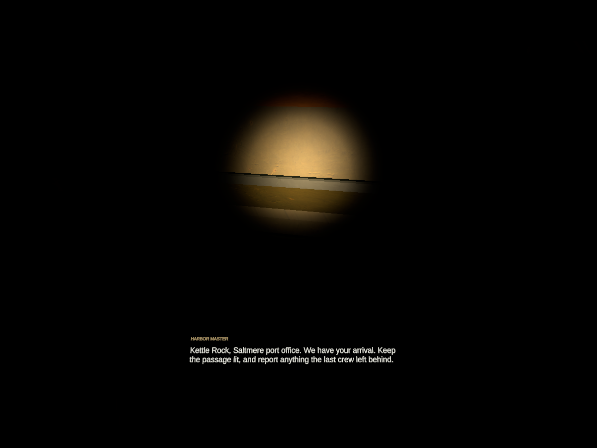
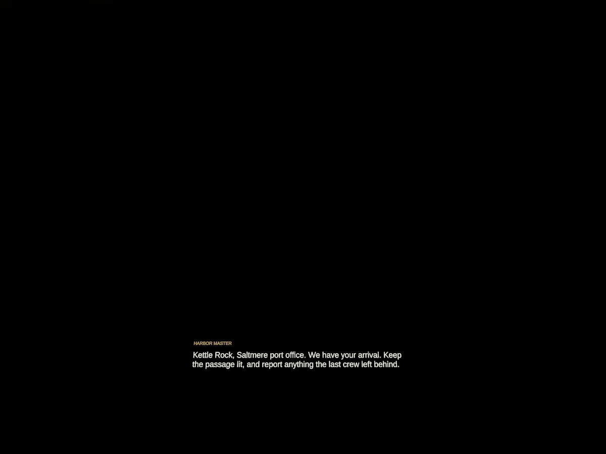

# Hard hats and headlamps — Editor evidence

The avatars' beanies were replaced with fitted hard hats and lamp housings. The local first-person body remains headless so it cannot occlude the tracked view. In the active game, each keeper has a shadowless, automatically active spotlight attached to their head pose; Owen uses his posed head, and the second human uses the existing replicated head pose. The old flashlight pickup and its waist slot are no longer spawned. Beam intensity is 48.6, up from 36 (35%); range and cone are unchanged. The host uses line of sight and the existing light-exposure timer for the Drowned.

The Blender [front](avatar-front.png) and [three-quarter](avatar-three-quarter.png) renders were inspected. These are authoring renders, not headset views. The two Editor captures below show the F2 wall with the automatic beam on and off, before generator power; they are not measurements of F2's powered bulb or a Quest render.

Muted Editor verification: 70 focused checks across lighting, campaign order, M3 state/retry, Survival, voice version and story import; 2 headlamp PlayMode checks (gaze following/no old handheld, wall blocking); 16 avatar checks and 3 first-person body PlayMode checks. A real two-Editor Photon session showed two active headlamps and two lit replicated states on each peer, with staged paired generator and pipe instructions. It did not test human grips, a full night, voice, rejoin, worn comfort or Quest GPU cost.

Network: `LK-S5-HEADLAMP1 / LK-Lab-Coop-v56` for this step. Both peers need matching builds. GPU cost, glare, helmet appearance on a moving partner/Owen, head-tracked illumination and powered F2 brightness need a worn Quest check.
