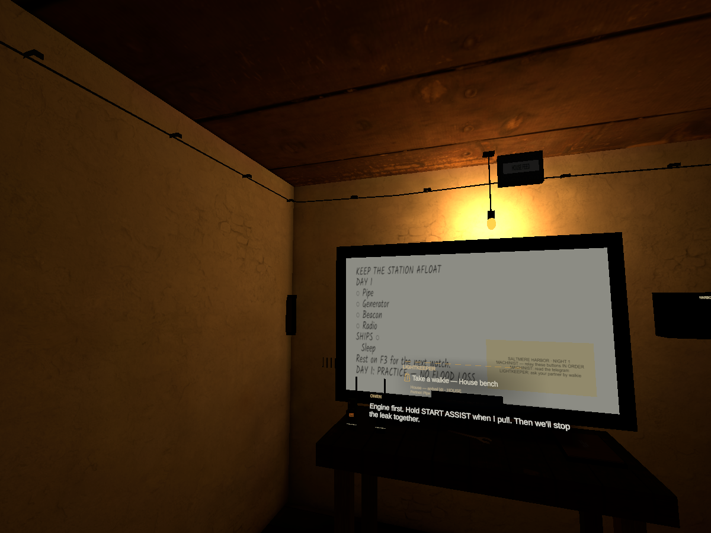
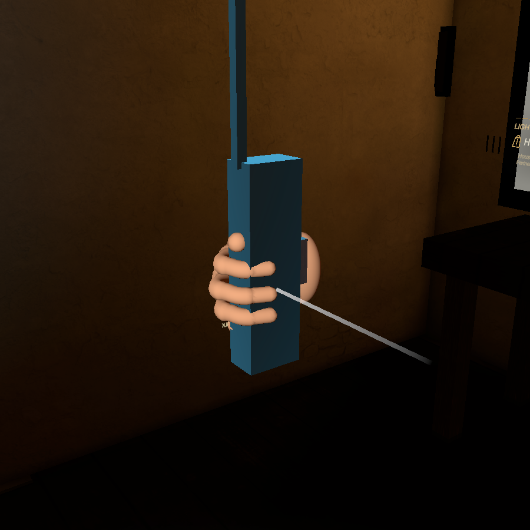
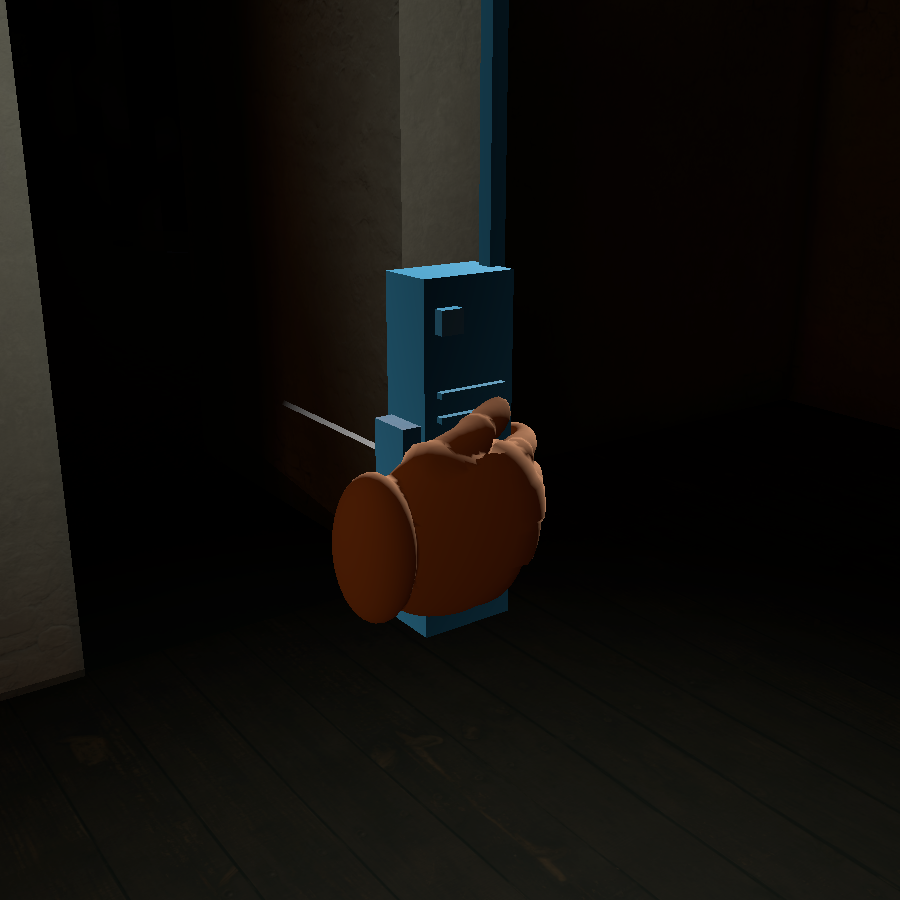

# November 18: House light, walkie orientation and practice day (#142)

Survival Day 1 now gives new keepers room to learn. Water rises at 40% of the original Day 1 rate (half the previous build's rate), stops at 0.22 m and cannot cause a flood loss. Lantern oil does not run out on this practice day. All station steps, paired support, the radio exchange and aiming the ship through the passage remain required before sleep. Day 2 restores flood-loss pressure and oil consumption; its existing 10% flood cushion remains. Campaign rules are unchanged.

The House instruction bulb has a larger baked pool, stays on through generator loss and dips gently without going dark. Tower bulbs have more pronounced, slow dips when powered. Powered and blackout maps were rebaked; no realtime fixture lights were added. Baked surfaces are modulated per room to follow the filament. This is baked Unity lighting, not realtime path tracing. Moving lanterns retain the existing realtime light.

The walkie case turns 180 degrees in the carried grip, with its aerial upright. Compensated left/right visual contacts retain the wrapped fingers; the belt pose is unchanged.

Matching clients use **LK-S5-PRACTICE1 / LK-Lab-Coop-v50**. There are no new snapshot fields; the matchmaking version changes because both clients must use the same practice-day tuning.

## Verified

Editor audio remained muted. **58 focused EditMode tests passed**, including the practice-day → completed ship → shared state → Day 2 loss transition. **32 actual XRI grip/regrip checks passed** for both walkies, lanterns and four beacon rim points. A live Play Mode check forced water above the threshold and observed the controller cap at 0.22 m without a loss. With the engine off and both lanterns off, emergency lightmaps were selected and the House filament remained lit throughout sampled dips. [World results](world.json), [input checks](grips.json), [test counts](tests.json), [bake record](bake.txt).

Both map sets have two maps and 444 probes covering 2,227 static renderers. The bake report is build evidence, not a Quest GPU measurement. The House blackout screenshot below uses gameplay lighting. Tool closeups use a temporary review light to inspect grip geometry. All images were inspected.

## Pending headset acceptance

1. Start Survival Day 1. Pause to read the briefing and practise controls: flooding must not end the watch, and the lantern must retain its oil.
2. Switch the generator off. The House instruction bulb should remain readable and dip gently; tower rooms should remain dark.
3. Grab the walkie in each hand, raise it to your mouth, and clip/retrieve it at the belt. Check which face points toward you and whether the fingers sit naturally.
4. Start the generator. Check slow flicker and navigate with LOW/HIGH lantern settings; report unreadable controls or uncomfortable lighting.
5. Finish all jobs, guide the ship and sleep. Day 2 must restore real flood pressure and oil consumption. For human co-op, update both devices.

Not verified this pass: worn grip/lighting comfort, first-time completion times, sustained Quest CPU/GPU or a fresh live two-Editor/two-headset run. Previous transport evidence remains in [EquipmentRelay](../EquipmentRelay/README.md). #142 stays open with needs-headset-check. APK `cec81c8e` is built and installed on Quest 3, **not launched**. Normal package, ARM64, VR category, signature and installed SHA-256 were verified. [Delivery receipt](delivery.json).
