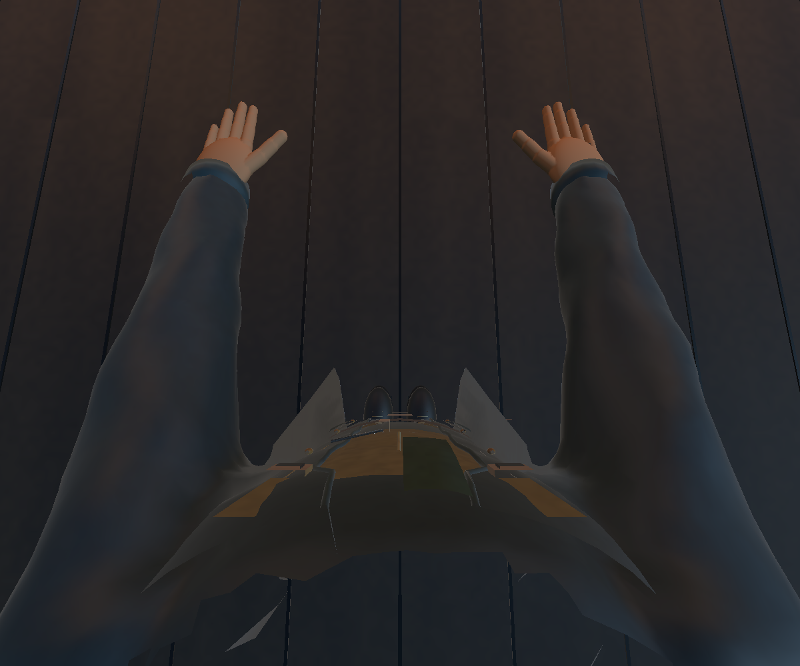
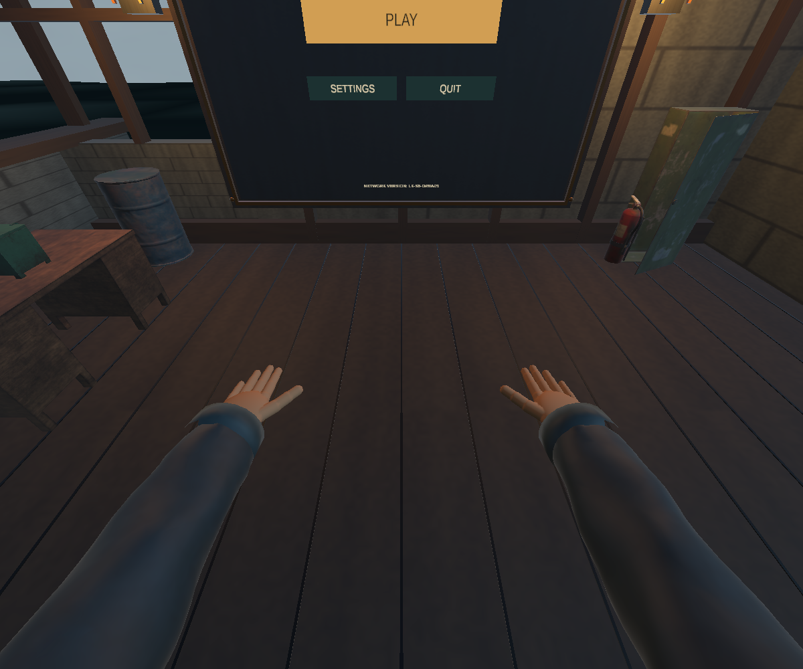
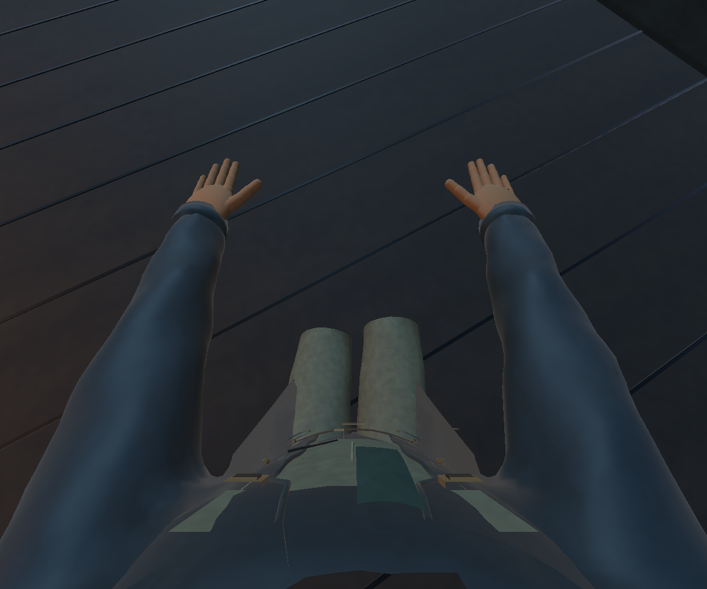
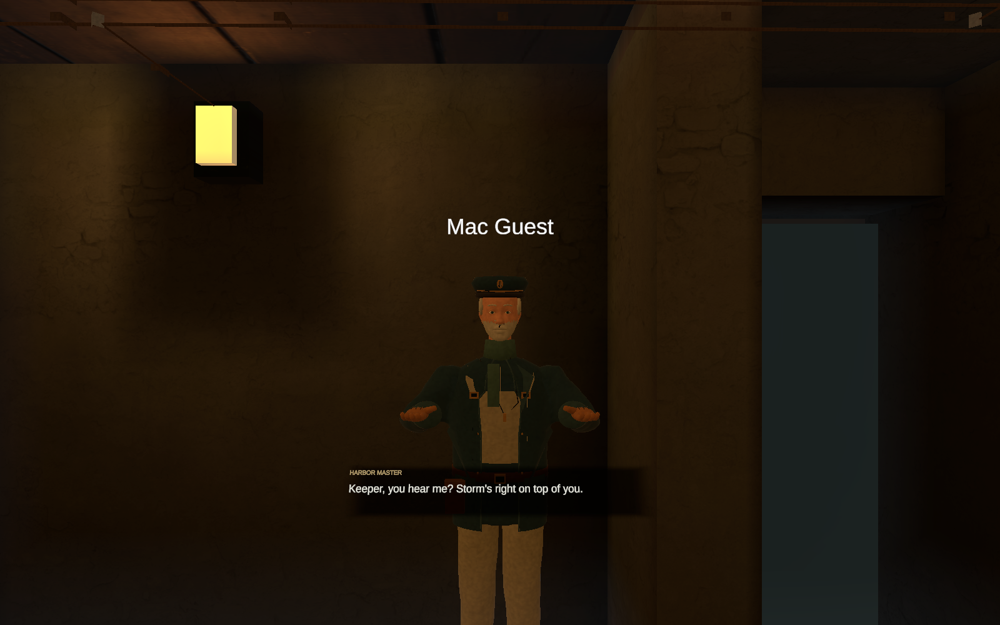

# Keeper headset regression correction — November 16, 2026

Issue #129, sprint-5 / draft PR #89. Network unchanged: **LK-S5-DREAD1 / LK-Lab-Coop-v33**. Original tracked hands, rotations and interaction inputs remain unchanged.

## What was wrong

The user's headset screenshots supersede the earlier staged avatar acceptance. Two distinct faults were reproduced:

1. The local solver inferred the floor from its first head sample. A startup height of 2.9 m followed by 1.65 m left the inferred floor at approximately 1.235 m; its limited ray search then rejected the real floor. Hips and shoulders ended up around the head. [Before reproduction](startup-before.png).
2. The old **Stabilized chest proxy** cube was still enabled in the shared Quest rig/lobby. It was the flat cloth rectangle in IMG_0510, independent of the new skin. The prefab and authoring source now disable it; old scene overrides are suppressed by the obsolete component at runtime.

The diagnostic-only APK 630fe719 did not fix either issue. A fresh user launch looked better, consistent with the transient startup case; no device startup trace was recovered from that run, so the cause is proven in Editor, not directly sampled on the headset.

## Correction

- Local skin waits for tracked head data and a stable floor-relative eye height. It uses the XR locomotion floor every pose, scales to standing height, and keeps that stature during crouching. Standing taller after an initially seated calibration refits upward. Calibration is local, not a network field.
- Sleeves target the existing glove wrist bones. Original hand transforms, grips and rotations are read only. Skin stays a world-space cosmetic sibling, avoiding XR-origin scale inheritance.
- Arm-swing running now binds hands even when created before XR hands, detects held objects instead of treating a squeezed empty grip as a held tool, tolerates normal swing-reversal pauses, and measures swings along the player's facing direction. Existing +60% easing/comfort and no boost while standing/holding props are retained. Running is in the watch scene, not the lobby.

## Evidence and limits

- 27 EditMode checks: keeper7, legacy humanoid8, limb IK6, Dread/running6. All pass. Three PlayMode regression checks pass (startup/recenter/short stature/crouch, actual glove targets/turns, legacy chest override).
- Real lobby graphics with the production local presenter and tracked-pose fixtures: eye heights1.35/1.65/1.9m, turns, look-down and crouch. Inspected images below. These are Editor captures, not Quest stereo acceptance.
- Two independent muted Mac Editors: join/start; both remote keepers visible and own network body hidden; guest crouch and wrist motion delivered; guest physical pipe task shared; both sleep into Night2. Night1 valve is not required, so no new valve-gate claim. Safe preview passage was advanced in simulation for this regression.
- Offline solo Night1: actual XRI wrench/three bolts, safe preview, sleep into Night2; zero captured errors. Arm-swing component is bound to both real HandRig instances and locomotion in the watch scene. Gesture acceptance is still a headset check.
- First uncapped two-Editor attempt disconnected shortly after load with input-buffer warnings. Repeating the same check with both test Editors capped at72fps passed. No networking code changed. Human voice listening remains unverified because Editors are muted.
- One new test initially named the wrong C# assembly for the legacy component; fixed the test to reference the actual runtime type, then all3 passed. No gameplay workaround.

Device acceptance remains pending: user must open the installed correction, look down, raise hands, crouch/stand, and then move with alternating arm swings in the House. Worn-device CPU/GPU and stereo fit are not inferred from these tests.
