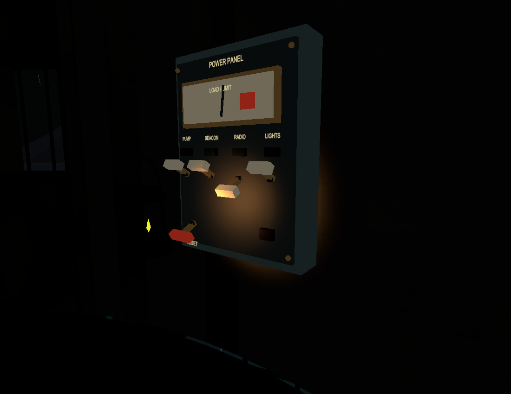
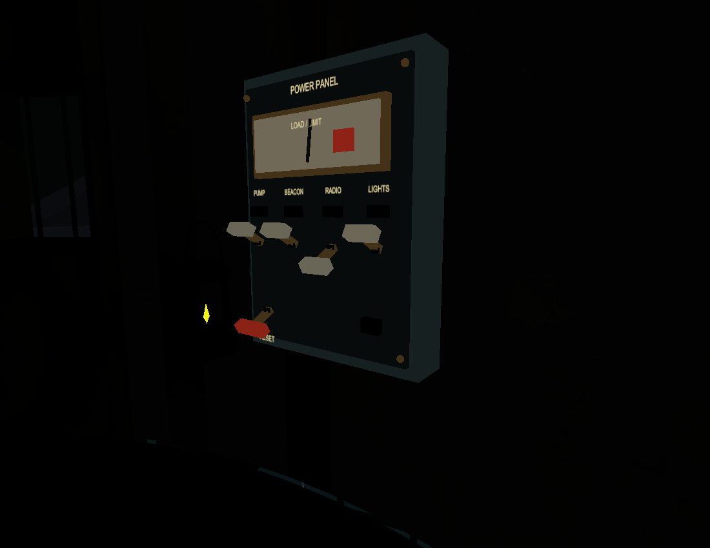
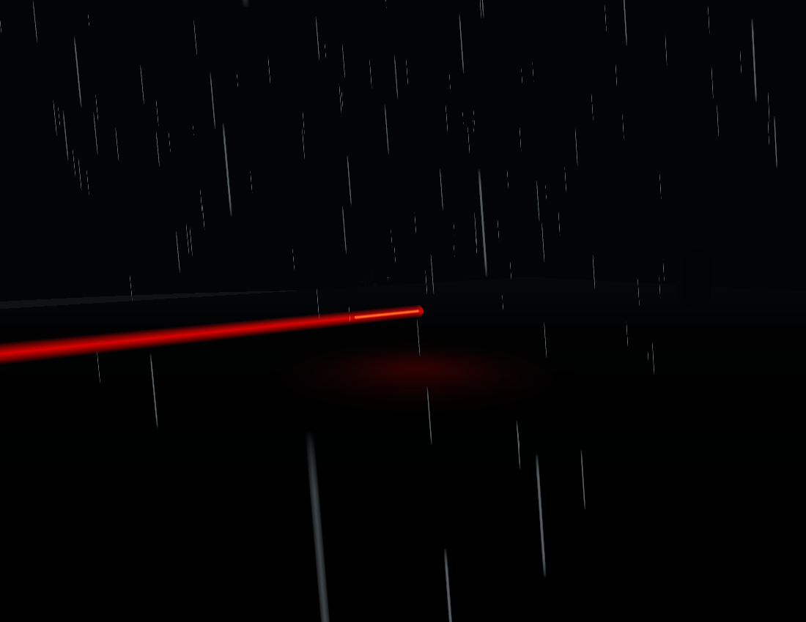
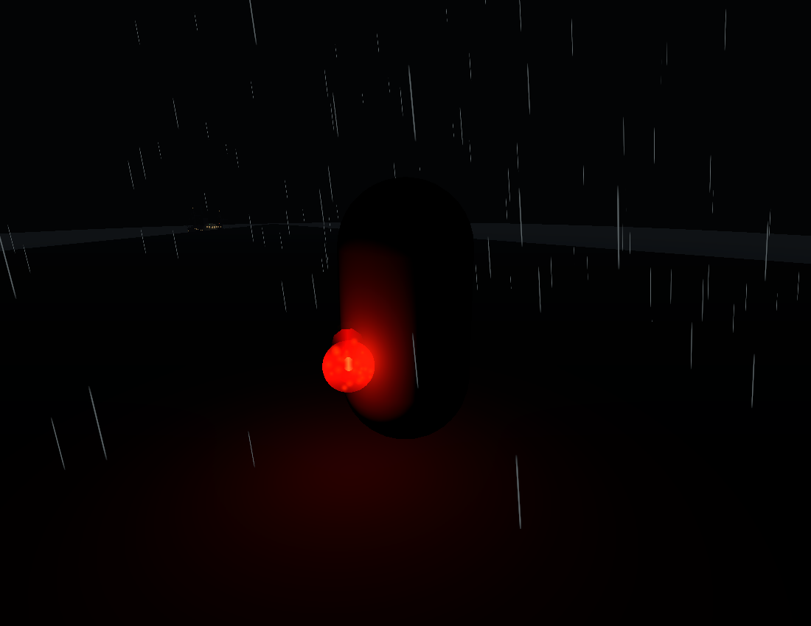
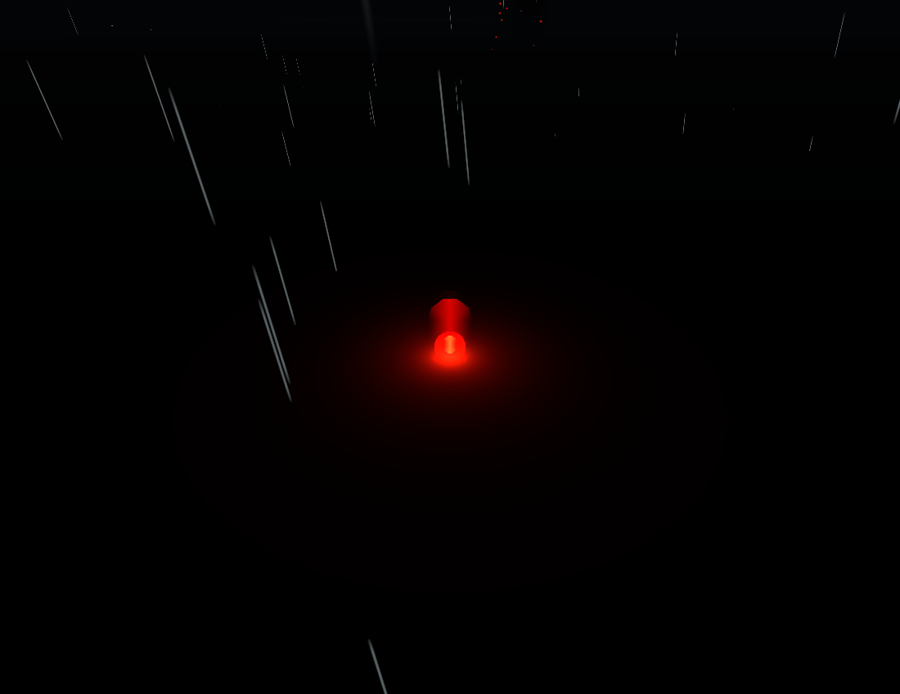

# Part 0 — lantern, A run, X breath, visible flare (#143)

Implemented on sprint-5. This is the controls/weapon foundation only. The new Day 2 nightmare, Day 3 cursed ship, their dev buttons and new scene voices are **not implemented** in this checkpoint; #144 and #145 remain open.

- Hold right-controller A while walking: +60% speed for 4.5 seconds. Release to refill over 3 seconds. Below 15%: one gasp and light haptic. Arm-swing run was removed. X holds breath; Y/wrist/B recall remains. Menu, briefing and possession cannot run.
- Day 1 oil remains unlimited in Campaign and Survival. Pickup teaches the exception; later days teach LOW versus HIGH and refilling from the F2 oil can, with a low-oil reminder. Water still extinguishes a submerged lamp.
- Lantern is a forward 85° spot / 55° inner cone, feathered cookie, LOW 0.8 m / HIGH 1.5 m; turns with the tool, not the head. Quest asset retains the existing Per Pixel setting (Unity enum value 1), limit 2.
- Flare travels 50 m/s with slight drop; bounded swept collision ignores keeper/gun geometry and catches a moving target. Walls take precedence. One shared round; host collision, replicated trajectory/impact. Red trail, muzzle flash/crack/kick, hit burst with up to 24 sparks and burn/collapse for the existing apparition; misses burn 8 seconds. One temporary shadowless point light is documented in QuestQuality.md.
- Fixed a live test finding: flare flight had depended on the paused watch clock. It now has its own host-owned replicated clock, including during start grace. X input is a short host-owned duty lease, not a stuck toggle.
- Network: **LK-S5-SCARES1 / LK-Lab-Coop-v51**. Both players must update (breath bitmask and independent flare clock added).

## Actual verification

76 focused EditMode tests passed (summaries in editmode.json). The two FlareSweepPlayTests UnityTest IEnumerator methods were executed in live Play Mode: 16 distance/hand/motion combinations (2/5/10/20 m × two hand origins × still/moving), thin wall first, and guaranteed miss. The Pipeline async test-runner job stalled on reload; the same assertions were run directly, not reported as a completed Test Runner suite. Both Editors were muted.

Two actual Photon Editors joined Campaign Night 2. Guest grip and trigger inputs produced host hits with identical stop positions on the guest; guest duty-2 breath input arrived and expired. Elevated isolated target/platform and test-only flood/lesson suppression kept the fixture stable. This was focused transport testing, not a complete co-op night or audible voice test. A peer CoreAudio crash required one Editor restart; its crash reporter was closed. No project audio settings changed.

Inspected the five images below. Forward/away captures show local control illumination changing while the camera stays fixed. Flight, hit and burning-miss captures use an isolated capsule target in the actual storm renderer; they are mechanics evidence, **not** the cursed figure or completed scare art. Additional live checks confirmed flight/impact continues with watch time held at zero.

## Device checks pending

Both-hand tool direction, A stamina timing with held tools, gasp/kick volume and comfort, X breathing, B/Y recall; Day 1 unlimited oil and Day 2 refill guidance; flare readability/hits/misses in rain, two-headset receipts and sustained GPU/CPU with two HIGH lanterns plus flare. No worn acceptance or performance numbers are claimed. Routine AI narration stays disabled; the obsolete arm-swing cue 102 placeholder and its exact caption were replaced with the new A instruction, using even caption timing until a human recording arrives.

## Six-step headset test for this checkpoint

1. Survival Day 1: take a lantern; confirm the unlimited-oil hint. Leave it on HIGH while learning the controls; it should not drain or cause an early flood loss.
2. Turn the lantern toward and away from a nearby wall, then turn only your head: the beam must follow the tool. Compare LOW/HIGH. Do not submerge it for this check.
3. Walk while holding A, including while carrying a tool: run for about 4.5 seconds, notice the low-stamina cue, release for 3 seconds, repeat. Swinging arms alone must not run.
4. Hold X: keeper breathing stops; release: it returns. Check B recall and Y/wrist recall still work.
5. Campaign DEV Day 2: take the House-bench flare pistol. Grip and trigger once at a wall/floor; see the red flight and burning miss, hear the crack and feel the kick. Retry for the other hand. Check the Day 2 lantern oil/refill hint too.
6. With both headsets on this version, have the guest shoot during an existing apparition. Both should see the same hit/burn/retreat, or the same burning miss. The new nightmare/cursed-ship dev buttons are not available yet.

Build guard caught and rejected an incorrect numeric enum edit in the first build attempt; restored the existing Per Pixel setting before delivery and repeated the visual capture at the corrected lamp distance. No failed build was installed.
