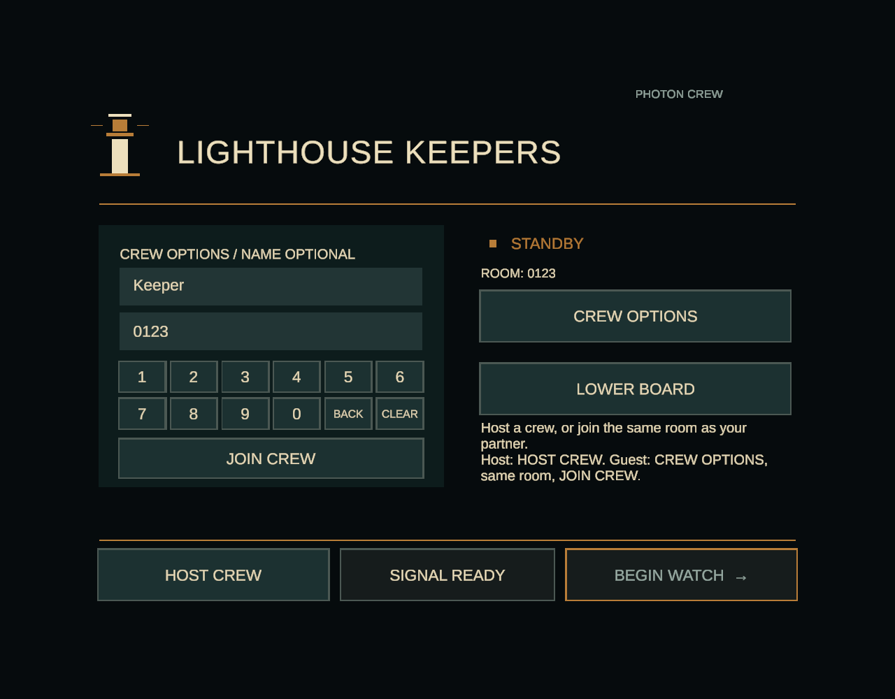
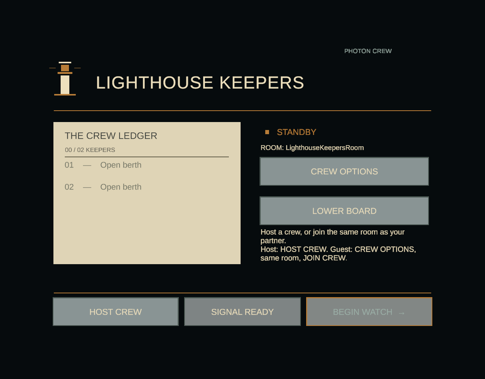

# Sprint 3 technical candidate verification

This evidence covers the controller lobby, existing local station controls and Quest packaging changes. It does not establish target-headset acceptance or a completed Sprint 3 submission.

## Rendered lobby checks

Unity **6000.3.23f1**, installed Unity CLI, Play Mode with graphics enabled: **6 passed, 0 failed, 0 skipped**. [Sanitized NUnit report](LobbyRendered.xml). This fixture uses a deterministic lobby transport, not Photon or a second device.

The tests exercise numeric entry, leading zeroes, backspace/clear/empty-room recovery, optional default name, host/guest code equality, busy/cancel state, readiness gating and visible next-action guidance. The rendered check uses the tracked-device UI raycaster and pointer events on every keypad button. It verifies 64-digit/wide-character room captions fit, buttons stay inside their panel and captions avoid neighboring controls.

These captures are isolated Editor UI renders with a verification camera, visually inspected for layout. They do not show headset execution, the full environment or measured VR readability/comfort.





## Interaction scope

The four existing legacy levels retain their sixteen named PuzzleSockets and anchor contracts. Their local controls support valve twist/regrip, reversible lever and dial input, and balanced held-radio press/release/drop/disable. Moving source visuals stay outside static render batches. The existing starter lever is explicitly active; tests check active ancestors and visible moving renderers.

These are local interaction hooks adapted from Tapan's open basic-interaction proposals (#48/#54/#55/#56). They do not add network ownership, voice transport or new Storm Watch puzzle rules. The production two-player, three-watch rules remain unchanged.

## Build and device boundary

Use the [Quest build pipeline](../StormWatch/QuestBuildPipeline.md) for a fresh source-recorded APK and final archive/manifest/native-library/signature checks. Builds and APKs stay outside Git.

No Quest is connected for acceptance. Immersive cold launch/restart, real-controller reach/hover/readability, two independent clients completing a watch, final audio mix, comfort/performance and actual headset video remain open in #59/#60/#31/#5/#19/#37/#62. Passing Editor or packaging checks does not close those tickets.

Raw Editor command lines and runtime log output are omitted from committed NUnit reports; test names, results and timings are retained.

## Combined interaction and networking regression

The affected Play Mode fixtures ran together with `LK_FUSION_CLOUD_TESTS=1 LK_RUN_ONLINE_TESTS=1` and `-nographics`: **20 passed, 0 failed, 1 intentionally skipped** ([sanitized NUnit report](PlayModeAffected.xml)). The skipped tracked-pointer/rendering case passed separately in the six-test graphics fixture above. This selection includes BasicInteractionSceneTests, BasicInteractionTests, LobbyControllerEntryTests, FusionLobbyIntegrationTests, BootstrapIntegrationTests and StormWatchSceneTests.

Both opt-in real-Photon cases passed: roster/readiness/late join/kick/disconnect, and same-runner watch launch/shared gameplay. These are two peers inside one Editor, not two independent devices. Offline scene handoff/return, production Photon selection, authored socket contracts, interaction behavior, night lighting/gates, partner-input launch gating and physical pumping/disconnect/restart also passed.

The scene fixture now owns and cleans up its temporary XR manager and asserts that manager instance IDs return to the pre-test baseline. Earlier full-suite attempts were interrupted before a verdict while diagnosing slow rendered environment tests and this fixture leak; they are not counted as passes. First Watch and traversal Play Mode fixtures were not rerun to completion on this candidate.

## Complete Edit Mode and verifier regressions

**79 passed, 0 failed, 0 skipped** in the complete Edit Mode suite ([sanitized NUnit report](EditMode.xml)), including four Quest manifest cases. Python APK-verifier regressions: **4 passed** using `python3 -m unittest discover -s Tools/tests -v`.

Reproduction uses Unity6000.3.23f1 and the installed CLI, with the isolated checkout passed explicitly:

```sh
unity --non-interactive test /absolute/path/to/LighthouseKeepers --mode EditMode --output /tmp/edit.xml -- -nographics
LK_FUSION_CLOUD_TESTS=1 LK_RUN_ONLINE_TESTS=1 unity --non-interactive test /absolute/path/to/LighthouseKeepers --mode PlayMode --filter 'LighthouseKeepers.Tests.BasicInteractionSceneTests;LighthouseKeepers.Tests.BasicInteractionTests;LighthouseKeepers.Tests.LobbyControllerEntryTests;LighthouseKeepers.Tests.FusionLobbyIntegrationTests;LighthouseKeepers.Tests.BootstrapIntegrationTests;LighthouseKeepers.Tests.StormWatchSceneTests' --output /tmp/affected.xml -- -nographics
LK_CAPTURE_SPRINT3=1 unity --non-interactive test /absolute/path/to/LighthouseKeepers --mode PlayMode --filter LighthouseKeepers.Tests.LobbyControllerEntryTests --output /tmp/lobby-rendered.xml
```

The graphics fixture omits `-nographics`. Add `--editor-path` if the correct Editor is not selected automatically. The online flags create temporary Photon rooms.

## Production beacon input isolation

The new legacy bearing wheel shared space with Storm Watch's centre beacon control. Only that added legacy dial now hides at startup when the active watch director supplies the production beacon controls. Existing socket/anchor transforms and watch rules are preserved. The dial stays active in plain legacy scenes/rehearsal.

The combined affected suite was rerun after this correction: **20 passed, 0 failed, 1 graphics-only skip covered by the rendered fixture**. Its Storm Watch scene test queries the actual centre control with a Default-layer physics overlap, asserts that no other active interactable competes there and confirms the production control remains physically selectable. The legacy-only scene test separately confirms its dial remains active.

An initial APK build was stopped during native compilation to apply this correction. It produced no deliverable or passing packaging result. Only the subsequent source-recorded, fully verified APK is eligible for publication.

## Published APK evidence

[Candidate release](https://github.com/Vanderbilt-VR-2026/LighthouseKeepers/releases/tag/sprint3-tech-candidate-20261027) · [APK](https://github.com/Vanderbilt-VR-2026/LighthouseKeepers/releases/download/sprint3-tech-candidate-20261027/LighthouseKeepers-Sprint3-e88f4e1c-20261027T202736Z.apk) · [Build record](https://github.com/Vanderbilt-VR-2026/LighthouseKeepers/releases/download/sprint3-tech-candidate-20261027/LighthouseKeepers-Sprint3-e88f4e1c-20261027T202736Z.build.json) · [Binary verification](https://github.com/Vanderbilt-VR-2026/LighthouseKeepers/releases/download/sprint3-tech-candidate-20261027/LighthouseKeepers-Sprint3-e88f4e1c-20261027T202736Z.verification.json) · [Checksums](https://github.com/Vanderbilt-VR-2026/LighthouseKeepers/releases/download/sprint3-tech-candidate-20261027/SHA256SUMS).

Built from clean source `e88f4e1c99cee75588758196fa149a199bcd1559` with Unity 6000.3.23f1: **Succeeded, 0 errors, 4 warnings**, nine production scenes, ARM64 IL2CPP Development APK, **90,254,809 bytes**. SHA-256: `c74e0542be57e0a1a65f0571144ecdf7fd3bd2cd8b933f43580724edd5aadecf`. The CLI exited successfully and the checkout remained clean after normal build postprocessing. These linked JSON records contain build/packaging evidence; raw Editor logs are not published.

The final APK passes actual binary-manifest checks for the VR launcher category, required version-1 head tracking, configured supported Quest devices, focus awareness and Internet permission; ARM64 OpenXR/IL2CPP libraries, every ZIP entry CRC and Android signature also pass. No connected Android device was available (`adb devices`: zero), so launch, usability and two-device acceptance remain unperformed.

For comparison, the older published main APK (`8c15fc6`, SHA-256 `34545ffc679372a81df0976980d922c14adcde6e956c9b22d7070e8f314bfc80`) lacks the VR launcher category, head-tracking requirement, supported-devices and focus-aware metadata in its actual binary manifest. The new verifier rejects it. This establishes a published packaging defect; the reviewer's exact installed hash and headset reproduction are unavailable, so it does not establish a reproduced root cause or completed headset fix.

Build command used (absolute checkout path supplied):

```sh
LK_PYTHON=/Library/Frameworks/Python.framework/Versions/3.13/bin/python3 unity --non-interactive run /absolute/path/to/LighthouseKeepers --editor-path /Applications/Unity/Hub/Editor/6000.3.23f1/Unity.app --timeout 3600 -- -buildTarget Android -nographics -job-worker-count 2 -executeMethod LighthouseKeepers.Editor.StormWatchAuthoring.BuildQuest -logFile /tmp/lk3-apk-final.log
```

Choose your installed Python/Editor paths. Do not publish raw Unity command-line logs; remove authentication/session values before sharing diagnostics. The [pipeline guide](../StormWatch/QuestBuildPipeline.md) explains standalone binary verification and source-record binding.
