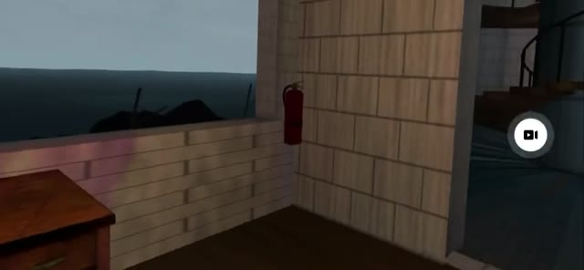

**[Team design document](Docs/DesignDocument.md)**

# Lighthouse Keepers

## Sprint 3 — Download for Quest 3

**[Download LighthouseKeepers-Sprint3.apk](https://github.com/Vanderbilt-VR-2026/LighthouseKeepers/releases/download/sprint3-final/LighthouseKeepers-Sprint3.apk)** · [Sprint 3 release and SHA-256](https://github.com/Vanderbilt-VR-2026/LighthouseKeepers/releases/tag/sprint3-final)

The release is published after the Sprint 3 PR is merged. If the download returns 404, publication has not finished; check the release page. The APK is built from the exact `sprint3-final` merge commit.

### Install and play

1. Enable developer mode in the **Meta Horizon phone app**: headset icon → paired Quest 3 → **Headset Settings → Developer Mode → On**. Use a verified Meta developer account in a developer team. See [Meta's device setup instructions](https://developers.meta.com/vr/documentation/native/android/mobile-device-setup/).
2. Connect the Quest using a USB data cable. In the headset, accept **Allow USB debugging**; select **Always allow from this computer** if offered.
3. Download the APK above. Install it with SideQuest's **Install APK file from folder** action, or run:

   ```sh
   adb devices
   adb install -r LighthouseKeepers-Sprint3.apk
   ```

4. In the headset, open **Library → Unknown Sources → Lighthouse Keepers**, then press **PLAY SOLO**. You should arrive inside the House beside the KEEPER WATCH board. See [Meta's sideloaded-app instructions](https://developers.meta.com/vr/documentation/android-apps/enable-developer-mode/).

PLAY SOLO loads the game locally and does not join Photon. Host-alone is available for debugging with an online crew session; finished two-player station synchronization is not claimed. The final Release APK's Wi-Fi-off headset check will be recorded in [the shipping report](Docs/OneLighthouse/M7.md).

### Controls

| Input | Action |
|---|---|
| Left stick | Move |
| Right stick | Snap turn |
| Grip | Grab nearby tools, starter handle, radio controls and microphone |
| Trigger | Interact/activate; hold while gripping the microphone to transmit; retry after watch loss |
| Wrist rotation | Turn the seated wrench or radio tuning knob |
| Grip near the F3 bed | Sleep after all board tasks are checked |

### The three-day loop

1. **Day 1:** Read the House board, take the wrench, repair three F1 couplings, and let the water drain.
2. **Day 2:** Restart the F2 generator with three pulls and repair F1; power restores the pump and beacon.
3. **Day 3:** Restore power, repair F1, and broadcast on F4: POWER → TUNE → CODE → hold mic trigger.
4. **After each completed day:** Sleep in the F3 bed; after Day 3, Day 4 is an explicit placeholder repeat for future content.

Power outages give soft pulsing emergency light. Restore the generator before the **BEACON DARK** countdown expires (90 s on Day 2, 75 s on Day 3); otherwise press trigger to retry that day. Pipe order varies: follow the glowing coupling, turn for ratchet clicks, return/regrip, and hold C steady before its final turn.

### Run from Unity

1. Clone the repository into a local folder outside cloud-sync directories:

   ```sh
   git clone --branch sprint-3 https://github.com/Vanderbilt-VR-2026/LighthouseKeepers.git
   cd LighthouseKeepers
   ```

   For the published release, use `git fetch --tags` then `git checkout sprint3-final`. During PR review, use `sprint-3`.
2. In Unity Hub, install **Unity 6000.3.23f1**, including **Android Build Support**, **Android SDK & NDK Tools**, and **OpenJDK**. Do not upgrade the project to a different Editor version.
3. Choose **Add project from disk** and select the repository root (the directory containing `Assets`, `Packages`, and `ProjectSettings`). Open with 6000.3.23f1. Let package resolution, asset import and C# compilation finish; internet is required for the first package download.
4. Photon Fusion is already in `Assets/Photon`. The configured `Assets/Photon/Fusion/Resources/PhotonAppSettings.asset` and its `.meta`, plus `Packages/manifest.json` and `packages-lock.json`, are committed. Do not import another Fusion SDK or replace shared app settings. All package references use registry/built-in sources, not a developer's local path.
5. Choose **Lighthouse Keepers → Play game**. It opens `Assets/_LighthouseKeepers/Scenes/Development/LK_NetworkLobby.unity`. In the Game view, select **PLAY SOLO**; the destination is `Assets/Scenes/Lab/LK_Lab_Environment.unity`. The ship scene list contains these two scenes only.
6. Click the Game view to use **WASD** movement and **Q/E** turning for desktop inspection. Desktop movement does not emulate tracked controller grabbing; play the APK on Quest for the station interactions. Development builds also expose **DEV: PLAY DAY 2 / DAY 3** shortcuts.
7. For automated checks, open **Window → General → Test Runner**, then **Run All** in EditMode and PlayMode. Full-suite results and named failures are in [M7 verification](Docs/OneLighthouse/M7.md). A fresh clone/open of the exact merged release commit is a separate post-merge check; it is not inferred from this working checkout.

### If the APK won't install

- In the Meta Horizon phone app, select the paired Quest 3 and open **Headset Settings → Developer Mode**. If the option is missing, confirm that the signed-in account is verified and belongs to a developer team, then reconnect the paired headset. [Meta developer-mode setup](https://developers.meta.com/vr/documentation/native/android/mobile-device-setup/).
- Keep the headset awake, reconnect a data-capable USB cable, and accept USB debugging. `adb devices` must show `device`; `unauthorized` means the headset prompt still needs approval.
- On Windows, install the [Meta/Oculus ADB driver](https://developers.meta.com/horizon/downloads/package/oculus-adb-drivers/) if the device is not detected. On macOS/Linux, use the SDK's `platform-tools/adb`.
- If Android reports `INSTALL_FAILED_UPDATE_INCOMPATIBLE`, an older build has a different signing key. Uninstall **Lighthouse Keepers** from the headset, or run `adb uninstall com.lighthousekeepers.game`, then install again. Uninstalling clears this app's local data.
- Confirm the download is the `.apk` asset, not GitHub's source ZIP, and compare its SHA-256 with the release notes. If installation succeeds but the app is not in the main grid, look under **Unknown Sources**.

### Known issues and credits

Some walls appear slightly transparent; wrench grip and hands/body polish remain deferred. Wristwatch, further day content, generator primer/choke and small debug issues are also deferred. See [BACKLOG.md](Docs/OneLighthouse/BACKLOG.md), [M4 verification](Docs/OneLighthouse/M4.md), and [M7 shipping status](Docs/OneLighthouse/M7.md) for actual evidence and remaining physical checks.

Reused team work: **Eli Gripenstraw** (flood and lobby foundation), **Tapan Sidhwani** (interaction patterns including radio push-to-talk), **William / Will Qian (`canwer1`)** (Photon/Fusion foundation and Sprint 2 networking), and **Nirvaan Nagaldinne** (team integration and demo documentation). **Aneesh Vasamreddy** authored the shell/environment and integrated the one-lighthouse experience. Commit/PR references are recorded in the M7 report.

## History

The following Sprint 1/2 and Storm Watch instructions are preserved for reference. Their old Bootstrap/StormWatch routes and APK links are historical; use the Sprint 3 instructions above for this submission.

### Storm Watch

Use **Lighthouse Keepers → Play game**. Host or join one crew room, signal ready on both clients, then **Begin watch** to enter the continuous three-watch cooperative climb together. The lobby connection carries gameplay too; no second Host/Join step is required. See [Storm Watch](Docs/StormWatch.md) for controls, progression and verification limits.

### Current main APK

**[Download the Quest APK built from main `8c15fc6`](https://github.com/Vanderbilt-VR-2026/LighthouseKeepers/releases/download/main-quest-8c15fc6/LighthouseKeepers-Main-8c15fc6.apk)**. This Android development build starts at the crew lobby and includes Storm Watch. See the [build record and checksum](Docs/Verification/MainAPK-20261015.md). Headset execution, connected play on Quest, comfort and device performance remain unverified for this APK.

The `sprint-2` branch starts at this same main commit. APKs are distributed through release assets and remain outside Git.

### William's four-player development environment

Use **Lighthouse Keepers → Development → Play environment** to open `LK_Bootstrap`. Its crew board supports one host and up to three guests, synchronized keeper poses, and shared authored grabbable props. It reuses `FusionLobbyTransport` for session lifetime; it does not launch a second runner alongside the lobby. See [development multiplayer setup and checks](Docs/Multiplayer.md).

The normal **Play game** entry retains the agreed two-player Storm Watch design. Four-player environment support does not rebalance its two-player mission rules. Live acceptance of the development replication layer remains pending.

### First playable watch

Use **Lighthouse Keepers → First Watch → Play plumbing escape** for the survival prototype: brace the pipe, turn three valves in the posted order, then escape to the first landing and recover. This is local solo practice with Quest hand interactions, a timed clamp option and desktop controls. See [First Watch](Docs/FirstWatch.md) for controls, scope and the dedicated Quest APK build command. The ordinary environment preview remains available below.

**Unity: `6000.3.23f1`. Connected lobby/gameplay integration: [PR #40](https://github.com/Vanderbilt-VR-2026/LighthouseKeepers/pull/40).**

**[Download the Sprint 1 APK for Meta Quest 3](https://github.com/Vanderbilt-VR-2026/LighthouseKeepers/releases/download/sprint1-quest3-20261001/LighthouseKeepers-Sprint1-Environment.apk)** — Android ARM64/IL2CPP development build. See the [release notes and checksum](https://github.com/Vanderbilt-VR-2026/LighthouseKeepers/releases/tag/sprint1-quest3-20261001). Headset walkthrough and performance verification remain pending.

Open this checkout, then use **Lighthouse Keepers → Play game**. The default entry scene is the Photon crew lobby, `Assets/_LighthouseKeepers/Scenes/Development/LK_NetworkLobby.unity`. Choose **Host crew**, or enter an existing room name under **Crew options → Join crew**; signal ready on both clients and begin the watch. Fusion launches Storm Watch on the same session, which loads the six content scenes. Click Game and use WASD/Q/E for desktop exploration. Photon is the normal game transport; local simulation is available only in the Development preview.

This Sprint 1 version contains the repaired lighthouse environment, floor/stair circulation, compact grounded pipework, ceiling fixtures and team code integration. The second and third floors are reserved for further furnishing; existing third-floor items and puzzle anchors remain. It is an environment foundation, not a completed puzzle/survival game. See [Sprint 1 publication](Docs/Sprint1Publication.md) for contributor commits, validation, branch guidance and pending Quest checks.

The local working folder is now `/Users/aneeshvasamreddy/LighthouseKeepers-Sprint1`. Teammates can clone anywhere; that path is not a project dependency. Android output: `Builds/LighthouseKeepers-Sprint1-Environment.apk`.

### Original setup guide — Sprint 1

### Sprint 1 demo
Where Sprint 1 landed, recorded on Quest 3 (48 s). Click the image to play the video.

[](Docs/Media/Sprint1Demo.mp4)

A standalone Quest 3 lighthouse environment foundation. Open with **Unity 6000.3.23f1 (Unity 6.3 LTS)** and install **Android Build Support, SDK/NDK Tools and OpenJDK** through Unity Hub.

Use **Lighthouse Keepers → Play game** or press Play to enter the Photon crew lobby by default. For isolated environment work, use **Development → Play environment**; Bootstrap loads six content scenes additively. Do not also load a second player rig. For isolated tests open `Assets/_LighthouseKeepers/Scenes/Development/LK_DevGym.unity`.

Editor preview without a headset: WASD walks; Q/E snap-turn. This preview uses character collision and gravity; it does not emulate tracked controller grabbing. Test interaction on Quest. In the Inspector, the persistent systems expose flood height, pause/reset and day selection. The DevGym overlay offers mouse-operated test controls. Select the ComfortSettings asset to configure movement, snap/smooth turning and vignette intensity. Changes to these shared settings affect the team; use a branch.

Quest controls: left stick walks relative to the headset, right stick snap-turns, grip grabs nearby interactables. Use the Quest system recenter gesture; a RecenterPlayer inspector action is also provided. No jumping, climbing or voice is implemented. The default Photon crew lobby supports roster, ready state and shared Storm Watch launch. Storm Watch shares keeper poses, inputs, flood, progression and rescue state through that same session; arbitrary legacy interactables remain local.

### Lobby and flood iteration

Choose **Lighthouse Keepers → Development → Play local lobby preview** to enter the keeper watch room. Use **Take your post → Signal ready → Begin watch** on the physical board. **Lower board** adjusts its height for seated use. Crew options include an offline guest simulation. See [the iteration guide](Docs/LobbyAndFloodIteration.md) for visual concepts, implementation notes and the Quest 3 test checklist.

The normal **Lighthouse Keepers → Play game** entry uses Photon hosting and joining. Host a room on one client and join the same room name on another; names, ready states and the host's scene launch are shared. See [Photon networking setup and scope](Docs/FusionNetworking.md). The published Sprint 1 APK predates the connected lobby and Storm Watch flow.

### Android build and USB test
1. Open File → Build Profiles, select Android and Switch Platform.
2. Confirm `LK_NetworkLobby` is first in the scene list, followed by `LK_StormWatch`, the development `LK_Bootstrap`, and the six content scenes. This is the normal Photon game startup. The historical Sprint 1 environment diagnostic builder explicitly selects its seven environment scenes.
3. Use **Lighthouse Keepers → Storm Watch → Build Quest APK**. Output: `Builds/LighthouseKeepers-StormWatch.apk` (Development Build, ARM64/IL2CPP, OpenXR). This uses the normal crew-lobby and Storm Watch scene list. The Sprint 1 environment builder remains a historical diagnostic path.
4. Connect Quest 3 via USB, allow debugging, keep it awake and turn on both controllers.
5. Install the downloaded APK with `adb install -r LighthouseKeepers-Main-8c15fc6.apk` (or use `Builds/LighthouseKeepers-StormWatch.apk` for a local build), then `adb shell am start -n com.lighthousekeepers.game/com.unity3d.player.UnityPlayerGameActivity`.
6. Verify the checklist in `Docs/ManualVerification.md`. An APK build alone does not prove comfort or 72 Hz.

The game is **Lighthouse Keepers**, package `com.lighthousekeepers.game`; it does not replace Spear Throw VR.

### Team entry points
Read EnvironmentArchitecture, TeamWorkflow, PuzzleSocketGuide and Sprint1Handoff in Docs. `Lighthouse Keepers → 03 Validate Sprint Foundation` checks authored assets. `02 Create Missing Sprint Scenes` is an authoring fallback, not a runtime generator. Existing scenes are preserved. Runtime code is under Scripts/Runtime; editor tooling stays out of the player build.

Audio clips prefixed `Placeholder_` are original procedural placeholders. They demonstrate routing and timing, not final sound design. Geometry/materials are original stylized foundation assets. The supplied reference image was not actually available in this session; the written direction guided the work. Final art, audio, balancing and headset acceptance remain future work; the current cooperative prototype is described above.

Common failures: wrong Unity version; missing Android modules; another Editor holding the project lock; USB debugging not authorized; starting a content scene without Bootstrap; stale package import after switching platform. Allow package resolution and compilation to complete. Do not install Unity AI Assistant to fix game setup. Keep asset/meta pairs together and never commit Library or Builds.

Exact automated results and remaining checks are in Docs/Verification and Docs/Sprint1Handoff.md.

The team-compatible editor version is now **6000.3.23f1**. Do not accept an automatic upgrade to 6000.5 when opening this branch. See Docs/Unity63Migration.md for compatibility changes and verification. Historical Sprint 1 test records describe their original editor versions.

### Inspect the September 23 environment integration

Use **Lighthouse Keepers → Development → Open complete environment** to load the seven authored scenes in the editor. Press Play, click Game view, then use WASD/Q/E for the desktop preview. This Development command explicitly starts from LK_Bootstrap for isolated environment work. Use **Play game** to return to the Photon lobby startup.

Selected Asset Store props, offshore fog and the streamed horror ambience are now included; the supplied water shader has an editor comparison material and a Quest-safe runtime fallback. See [integration changes](Docs/AssetIntegrationStatus.md), [asset provenance](Docs/ThirdPartyAssets.md) and [verification](Docs/Verification/AssetIntegrationValidation.md). Final sound balance, both-eye effects and sustained Quest performance still need headset testing.
