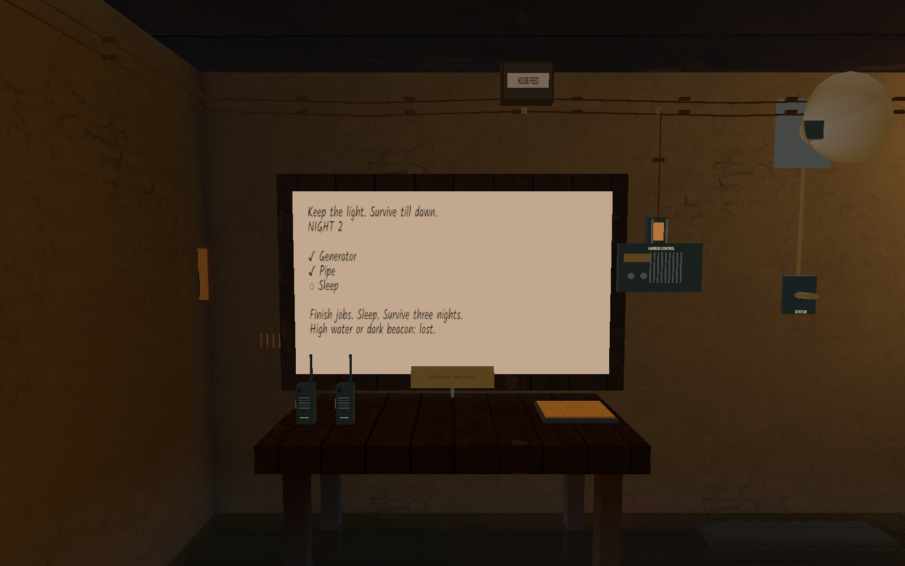

# Lighthouse Keepers

Keep a storm-battered lighthouse running, alone or with a friend, in **VR on Meta Quest 3**. Repair leaking pipes, restart the generator, route power and broadcast a warning before the water or darkness wins. Finish tonight’s jobs, rest in the upstairs bunk, and face the next watch together.

## Download & play

**[Download the Sprint 4 game (APK)](https://github.com/Vanderbilt-VR-2026/LighthouseKeepers/releases/download/sprint4-final/LighthouseKeepers-Sprint4.apk)** · **[Sprint 4 release notes and checksum](https://github.com/Vanderbilt-VR-2026/LighthouseKeepers/releases/tag/sprint4-final)** · Video: **coming soon**

**Professor / TA:** use Sprint 4 for the current playable submission. The table below preserves earlier hand-ins. **APK = game; MP4 = video.** You do not need Unity to play. Sprint 5 is work in progress, not the submitted finished game.

1. Download the **APK**, not GitHub’s “Source code” ZIP.
2. On the phone paired to your Quest, open **Meta Horizon → your headset → Headset Settings → Developer Mode** and enable it. If missing, follow the [account/setup help](Docs/INSTALL.md).
3. Connect the Quest to a computer with a USB data cable. Inside the headset, accept **Allow USB debugging**.
4. In [SideQuest](https://sidequestvr.com/setup-howto), choose **Install APK file from folder** and select the APK (or drag it into the installer). Alternatively: `adb install -r LighthouseKeepers-Sprint4.apk`.
5. On Quest, open **Library → Unknown Sources → Lighthouse Keepers**.
6. Press **PLAY → HOST / PLAY ALONE → START** to play alone. If there is no internet, use **START** on the **No connection — Play offline** message.

### Play together — two people

Install the **same Sprint 4 APK on both Quests** and connect both to the internet. The host chooses **PLAY → HOST / PLAY ALONE** and shares the six-character crew code. The friend chooses **PLAY → JOIN CREW**, enters the code and joins; the host presses **START** when both names appear. **There is no READY button.**

Both lobby screens must show **NETWORK VERSION LK-S5-PLAYTEST1** for this Sprint 4 release. This is an internal compatibility code, not the submission name. Different sprint builds cannot join each other. A partner can join an ongoing watch or rejoin with its current code. [Two-Quest help](Docs/TwoQuestSetup.md).

### Controls

| Control | What it does |
| --- | --- |
| Left stick | Walk |
| Right stick | Snap-turn |
| Grip | Hold tools, squeeze primer, pull starter/choke; grip the bed to rest |
| Wrench near active bolt | Auto-snap; pull toward yourself, reposition and repeat |
| Trigger | Menu selection; push-to-talk while holding the radio microphone |
| B | Recall objective and last announcement; double-tap to replay the announcement |
| Left controller menu button | Open Watch Menu: retry, return to lobby, audio and objective height |
| Look at left wrist / X or Y | Re-show the current objective |

Try **Night 1: pipe → water drains → bunk**; **Night 2: fuel/generator + pipe**; **Night 3: generator, pipe, beacon and radio**. In co-op, one keeper holds the pipe valve while the other repairs; both must rest to advance. [What we built and known issues](Docs/Sprint4.md).

## Sprints

| Sprint | Source branch | Release / APK | Review PR | Issues milestone | Video |
| --- | --- | --- | --- | --- | --- |
| 1 · Environment | [sprint-1](https://github.com/Vanderbilt-VR-2026/LighthouseKeepers/tree/sprint-1) | [Release](https://github.com/Vanderbilt-VR-2026/LighthouseKeepers/releases/tag/sprint1-quest3-20261001) · [APK](https://github.com/Vanderbilt-VR-2026/LighthouseKeepers/releases/download/sprint1-quest3-20261001/LighthouseKeepers-Sprint1-Environment.apk) | [#23](https://github.com/Vanderbilt-VR-2026/LighthouseKeepers/pull/23) | [Sprint 1](https://github.com/Vanderbilt-VR-2026/LighthouseKeepers/milestone/4) | See original branch history |
| 2 · Resubmission | [sprint-2](https://github.com/Vanderbilt-VR-2026/LighthouseKeepers/tree/sprint-2) | [Release](https://github.com/Vanderbilt-VR-2026/LighthouseKeepers/releases/tag/sprint2-final-v2) · [APK](https://github.com/Vanderbilt-VR-2026/LighthouseKeepers/releases/download/sprint2-final-v2/LighthouseKeepers-Sprint2.apk) | [Submission #70](https://github.com/Vanderbilt-VR-2026/LighthouseKeepers/pull/70) | [Sprint 2](https://github.com/Vanderbilt-VR-2026/LighthouseKeepers/milestone/5) | [MP4](https://github.com/Vanderbilt-VR-2026/LighthouseKeepers/releases/download/sprint2-final-v2/LighthouseKeepers-Sprint2-Video.mp4) |
| 3 · Three-night game | [sprint-3](https://github.com/Vanderbilt-VR-2026/LighthouseKeepers/tree/sprint-3) | [Release](https://github.com/Vanderbilt-VR-2026/LighthouseKeepers/releases/tag/sprint3-final) · [APK](https://github.com/Vanderbilt-VR-2026/LighthouseKeepers/releases/download/sprint3-final/LighthouseKeepers-Sprint3.apk) | [#65](https://github.com/Vanderbilt-VR-2026/LighthouseKeepers/pull/65) | [Sprint 3](https://github.com/Vanderbilt-VR-2026/LighthouseKeepers/milestone/1) | [MP4](https://github.com/Vanderbilt-VR-2026/LighthouseKeepers/releases/download/sprint3-final/LighthouseKeepers-Sprint3-Video.mp4) |
| **4 · Current submission** | [sprint-4](https://github.com/Vanderbilt-VR-2026/LighthouseKeepers/tree/sprint-4) | **[Release](https://github.com/Vanderbilt-VR-2026/LighthouseKeepers/releases/tag/sprint4-final) · [APK](https://github.com/Vanderbilt-VR-2026/LighthouseKeepers/releases/download/sprint4-final/LighthouseKeepers-Sprint4.apk)** | [#88](https://github.com/Vanderbilt-VR-2026/LighthouseKeepers/pull/88) | [Sprint 4](https://github.com/Vanderbilt-VR-2026/LighthouseKeepers/milestone/2) | Coming soon |
| 5 · In progress | [sprint-5](https://github.com/Vanderbilt-VR-2026/LighthouseKeepers/tree/sprint-5) | Preview pending; not a final submission | [Draft #89](https://github.com/Vanderbilt-VR-2026/LighthouseKeepers/pull/89) | [Sprint 5 · Dec 3](https://github.com/Vanderbilt-VR-2026/LighthouseKeepers/milestone/3) | Coming soon |

Sprint 2 installs separately as **Lighthouse Keepers S2**. Sprint 1, 3, 4 and 5 use **Lighthouse Keepers** and replace one another when installed. Earlier videos/APKs remain unchanged.

## Design and development

A physical crew ledger introduces the game; the House board and harbor master explain the watch. Equipment uses direct grabs, pulls, squeezes and tilts with visible progress. Short objective recall, captions and practical lights support clarity without an always-on panel.

[Run/build in Unity](Docs/DEVELOPMENT.md) · [Install troubleshooting](Docs/INSTALL.md) · [Sprint 4 details](Docs/Sprint4.md)

## History

[Earlier Sprint 4 immersion/audio milestone](https://github.com/Vanderbilt-VR-2026/LighthouseKeepers/releases/tag/sprint4-m1) · [All releases](https://github.com/Vanderbilt-VR-2026/LighthouseKeepers/releases) · [Archived branch history](Docs/Archives/Branches-2026-11-12.md).

Historical branches are preserved by archive tags before removal. **main** changes only after teammate review and merge. The six working/submission branches are main and sprint-1 through sprint-5.
